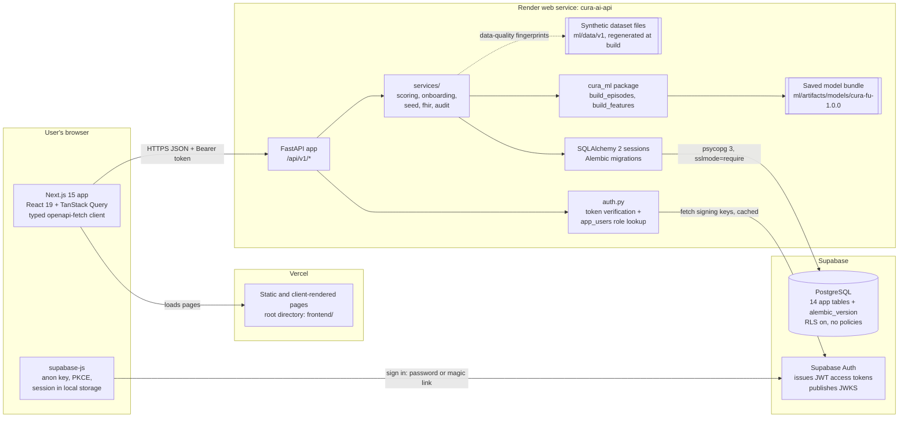
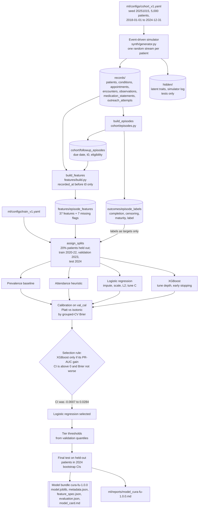
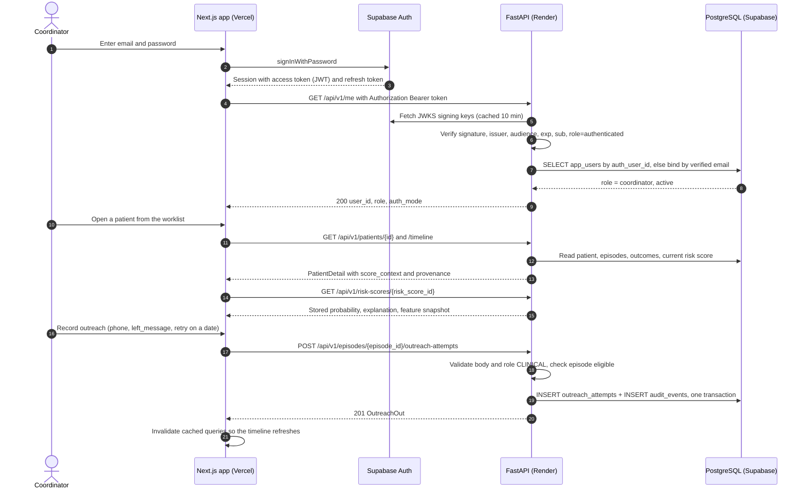
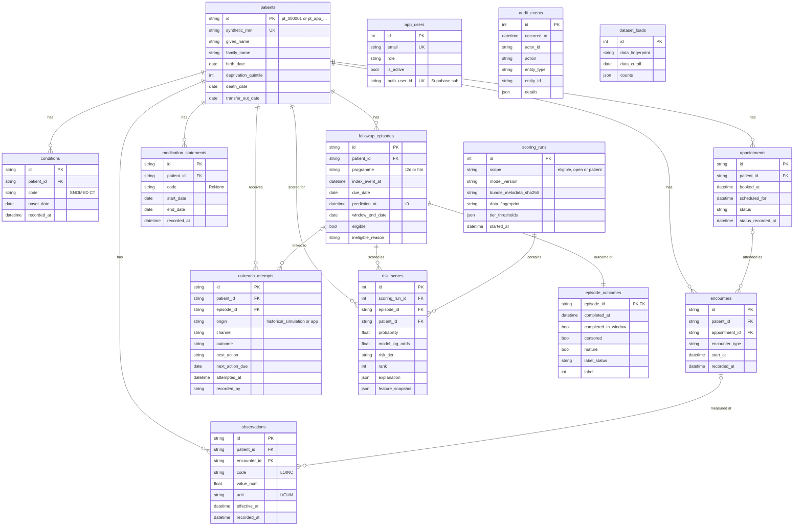
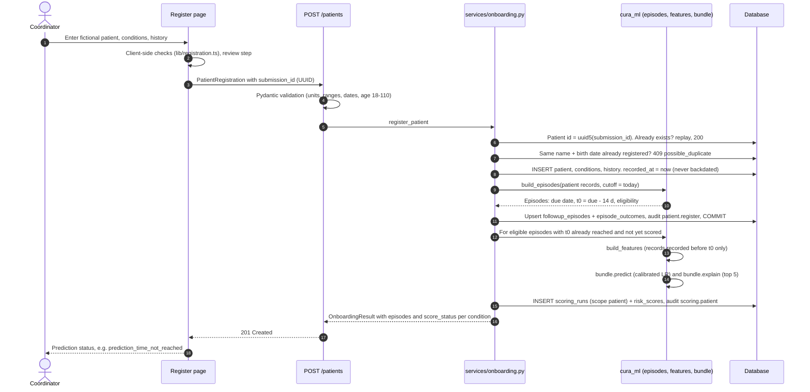
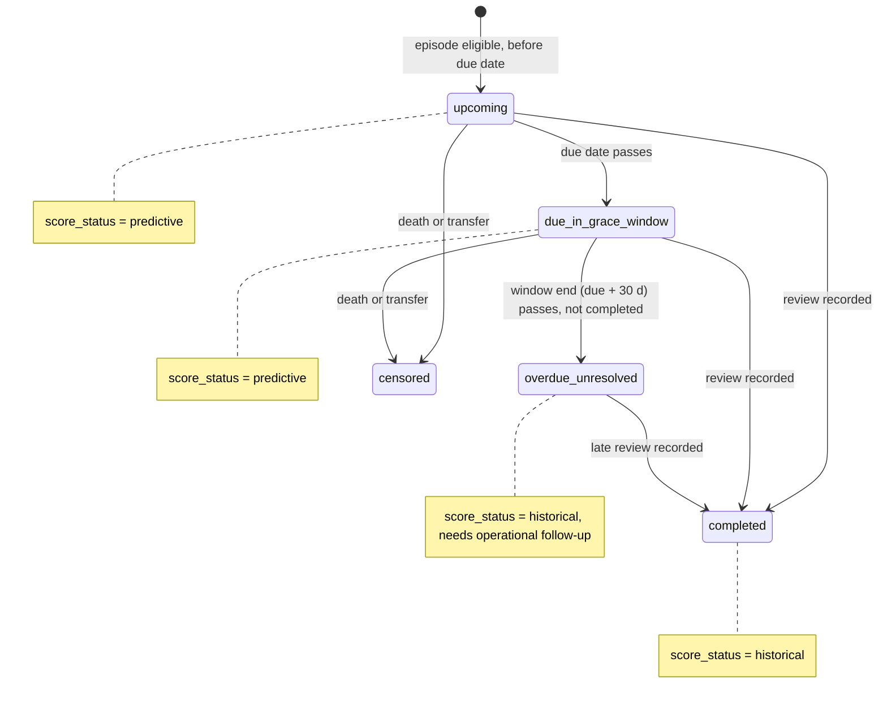

# Cura AI — chronic-care follow-up prioritisation

**Cura AI helps a care team decide which patients with type 2 diabetes or hypertension to contact first,
because their next routine review is likely to be missed. It shows why the model thinks so and records
what happened when the team reached out.**

> [!WARNING]
> **Synthetic demonstration data only. Not for clinical use.** Every patient, event, outcome and
> metric in this repository is simulated. The model predicts **follow-up non-completion**: whether
> an expected chronic-care review is still incomplete 30 days after its due date. It does not predict
> deterioration, hospitalisation or death. It does not diagnose and does not recommend treatment.
> Cura AI is a decision-support **engineering prototype**. It has not been clinically validated.

| | |
|---|---|
| **Live application** | https://cura-ai-chronic-care.vercel.app/ (sign-in requires a provisioned account) |
| **Repository** | https://github.com/kaleprabhat24/cura-ai-chronic-care |
| **Live API health** | https://cura-ai-api.onrender.com/api/v1/health |
| **Selected model** | `cura-fu-1.0.0`: calibrated logistic regression, 44 input columns, feature spec `fs-1.0` |
| **Headline test result (synthetic)** | PR-AUC 0.647 [0.588, 0.702] vs prevalence 0.291; precision 0.735 in the top 15% |

---

## Table of contents

1. [Quick start](#1-quick-start)
2. [The problem and what Cura AI does](#2-the-problem-and-what-cura-ai-does)
3. [Implementation and verification status](#3-implementation-and-verification-status)
4. [Feature guide](#4-feature-guide)
5. [Architecture](#5-architecture)
6. [Technology stack](#6-technology-stack)
7. [The machine-learning pipeline, from beginner to advanced](#7-the-machine-learning-pipeline-from-beginner-to-advanced)
8. [Database and data dictionary](#8-database-and-data-dictionary)
9. [API reference](#9-api-reference)
10. [Local setup on Windows, step by step](#10-local-setup-on-windows-step-by-step)
11. [Hosted deployment: Supabase, Render and Vercel](#11-hosted-deployment-supabase-render-and-vercel)
12. [Patient onboarding walkthrough](#12-patient-onboarding-walkthrough)
13. [Demonstration script](#13-demonstration-script)
14. [Technical interview questions and answers](#14-technical-interview-questions-and-answers)
15. [Troubleshooting](#15-troubleshooting)
16. [Limitations, security and roadmap](#16-limitations-security-and-roadmap)
17. [Development journey and engineering decisions](#17-development-journey-and-engineering-decisions)
18. [Glossary](#18-glossary)
19. [Repository layout and further documentation](#19-repository-layout-and-further-documentation)

---

## 1. Quick start

Windows PowerShell, run from the repository root (the folder that contains `README.md`). Needs Python
3.12 or newer (verified on 3.13.9), Node.js 20 or newer (verified on 22.16) and Git. Section 10 explains
every step.

```powershell
git clone https://github.com/kaleprabhat24/cura-ai-chronic-care.git
cd cura-ai-chronic-care
python -m venv .venv
.venv\Scripts\python -m pip install -e ml -e "backend[postgres]" pytest ruff httpx
npm --prefix frontend install
.venv\Scripts\cura-ml all            # synthetic dataset -> ml/data/v1 (about 12 s)
.venv\Scripts\cura-api db upgrade    # SQLite database -> backend/var/cura_dev.db
.venv\Scripts\cura-api seed          # load the synthetic cohort into the database
.venv\Scripts\cura-api score         # batch-score with the committed model bundle
```

Then start two terminals, both in the repository root:

```powershell
.venv\Scripts\cura-api serve          # terminal 1: API on http://127.0.0.1:8000 (docs at /docs)
```

```powershell
npm --prefix frontend run dev         # terminal 2: web app on http://localhost:3000
```

Open http://localhost:3000. Locally you sign in with the **development identity picker**: type any user
id and pick a role (`coordinator`, `analyst` or `admin`). No Supabase account, Docker or `.env` file is
needed for local use.

---

## 2. The problem and what Cura AI does

### 2.1 Why chronic-care follow-up gets missed

People with long-term conditions such as type 2 diabetes (T2D) and hypertension (HTN) are asked to
attend regular structured reviews. In this project a T2D review is due every 182 days and an HTN
review every 365 days. At a review, a clinician checks control (e.g. HbA1c or blood pressure),
medicines and complications.

Reviews are missed for ordinary reasons: invitations go unanswered, appointments are booked far ahead
and forgotten, patients have unstable periods in their lives, transport or work gets in the way, phone
numbers are wrong, or a clinic cancels and nobody rebooks. A practice cannot phone every patient every
time, so a care coordinator needs to know **which follow-ups are most likely to slip, and why**.

### 2.2 Who it is for

| Role | Typical person | What they do in Cura AI |
|---|---|---|
| `coordinator` | Care coordinator or practice nurse | Works the worklist, opens Patient 360, records outreach, registers patients and adds history, exports FHIR |
| `analyst` | Quality or data analyst | Reviews the dashboard, outcomes, model performance and data quality. Sees no patient-level views |
| `admin` | System administrator | Everything above, plus the audit log, user list, scoring runs and data quality |

### 2.3 What Cura AI solves, and what it deliberately does not

| In scope | Out of scope (by design) |
|---|---|
| Ranking open follow-ups by the predicted probability that the review will still be incomplete 30 days after the due date | Predicting disease deterioration, hospital admission or mortality |
| Explaining which recorded data drove each prediction | Diagnosis, treatment recommendations, clinical triage |
| Recording outreach attempts, outcomes and next actions | Measuring whether outreach *causes* better attendance |
| Separating live predictions from historical scores and from observed outcomes | Automatic retraining, arbitrary CSV import, bulk patient import |
| Registering fictional patients and scoring them with the saved model at the right moment | Use with real patient data |

### 2.4 Four things that are easy to confuse

The application keeps four kinds of information visibly apart. Most of the design follows from this.

| Concept | Meaning | Example | Where it lives |
|---|---|---|---|
| **Probability of follow-up non-completion** | A model output: "given what was recorded before the prediction time, how likely is this review to still be incomplete at due date + 30 days?" | `0.72`, tier **high** | `risk_scores` (provenance `simulated_prediction`) |
| **Condition severity** | How poorly controlled a disease is. **Not predicted by Cura AI.** A patient with an HbA1c of 11% can still be very likely to attend | HbA1c 11.2% | `observations` (clinical record) |
| **Overdue task** | An operational fact: the due date has passed and the review has not happened | "Overdue 40 d" | Derived from `followup_episodes` and `episode_outcomes` |
| **Observed historical outcome** | What actually happened after the prediction | "Completed late", "Not completed by window end" | `episode_outcomes` (provenance `recorded_synthetic_outcome`) |

Once the outcome window of an episode has closed, its stored probability is shown as **historical**,
never as a current prediction. An open episode past its window is an **observed outcome that needs
operational follow-up**, not a "high-risk" patient (ADR-018, `score_context` in the API).

---

## 3. Implementation and verification status

Evidence levels used in this README:

- **Implemented**: the code exists in this repository.
- **Test-covered**: exercised by the automated tests (178 Python tests, 29 frontend test cases).
- **Locally verified**: run end to end on a development machine with SQLite and dev sign-in.
- **Live-verified**: checked against the deployed services.

| Capability | Implemented | Test-covered | Live evidence |
|---|---|---|---|
| Synthetic cohort, episodes, labels, manifest | Yes (`ml/src/cura_ml/synth`, `cohort`) | Yes (`ml/tests`) | Render build runs `cura-ml all` |
| Leakage-safe features, training, evaluation, bundle | Yes (`features`, `modeling`) | Yes (time-travel test, split tests, reproducibility) | Bundle loaded by the live API (`model_bundle_available: true`) |
| FastAPI backend, SQLAlchemy models, Alembic migrations | Yes | Yes | Health endpoint returns `status: ok`, `database: ok` |
| Batch scoring snapshots | Yes (`cura-api score`) | Yes | Live health reports `latest_scoring_run_id: 1` |
| Worklist, Patient 360, outreach, outcomes, model & data pages | Yes (`frontend/src/app`) | Partly (API tests; frontend unit tests for score presentation, client, session, registration) | Reported working by the project owner |
| Patient onboarding (register, add history, score status, generate score) | Yes (ADR-022) | Yes (`backend/tests/test_onboarding.py`, `frontend/src/lib/registration.test.ts`) | Reported working by the project owner |
| Supabase Auth token verification and `app_users` roles | Yes (`backend/src/cura_api/auth.py`) | Yes, with locally generated keys | Live API runs `auth_mode: supabase`, `production_auth_implemented: true`, and returns 401 to unauthenticated requests |
| PostgreSQL + row-level-security lockdown | Yes (migration `0003`) | Migration SQL rendering only | Live database reachable; RLS state not checked in this pass |
| FHIR R4-oriented export | Yes (`services/fhir.py`) | Structural checks + `fhir.resources` R4B parsing | Not checked live |
| Official HL7 FHIR validator | **No** | No | No |
| CI (GitHub Actions), Playwright end-to-end tests | **No** (planned in `docs/ARCHITECTURE.md`, not present) | — | — |

**What was live-verified while writing this README (2026-10-16), with unauthenticated requests only:**
the Vercel frontend returns HTTP 200 with `X-Frame-Options: DENY`, `X-Content-Type-Options: nosniff`
and `Referrer-Policy` headers; its JavaScript bundle targets `https://cura-ai-api.onrender.com`;
`GET /api/v1/health` returns `status: ok`, `environment: production`, `auth_mode: supabase`,
`database: ok`, `dataset_loaded: true`, `model_bundle_available: true`; `GET /api/v1/me` without a token
returns 401; and a CORS preflight from the Vercel origin is allowed. Signed-in flows (worklist, onboarding,
outreach) were not exercised in this pass, because that needs a real account.

---

## 4. Feature guide

The frontend hides navigation a role cannot use, but **the API enforces every permission**. Hiding a
link is a convenience, not a security control.

### 4.1 Role matrix

| Capability | coordinator | analyst | admin | Enforced by |
|---|:-:|:-:|:-:|---|
| Dashboard, outcomes, current model summary and model card | ✓ | ✓ | ✓ | `ANY_ROLE` |
| Worklist, patient list, Patient 360, timeline, scores and explanations | ✓ | | ✓ | `CLINICAL` |
| Record outreach, register patients, add history, generate a score | ✓ | | ✓ | `CLINICAL` |
| FHIR export | ✓ | | ✓ | `CLINICAL` |
| Data quality, scoring runs, model by version | | ✓ | ✓ | `ANALYTICS` |
| Audit log, application users | | | ✓ | `ADMIN` |
| Add / change users and roles | CLI only: `cura-api users …` (audited as `user.add` / `user.update`) | | | No HTTP endpoint |

The role dependencies are defined in [`backend/src/cura_api/auth.py`](backend/src/cura_api/auth.py)
(`ANY_ROLE`, `CLINICAL`, `ANALYTICS`, `ADMIN`).

### 4.2 Feature by feature

Each entry gives: purpose · user journey · frontend location · backend endpoint and service · tables.

**Dashboard**
- *Purpose:* one-screen picture of the cohort at the data cutoff.
- *Journey:* sign in and land on `/`. You see open follow-ups split into upcoming, due (window open) and
  overdue-unresolved; predictive risk tiers (only for episodes whose outcome is still unknown); due-date
  load for the next 8 weeks; outreach totals; on-time completion over the last 12 months; model and
  scoring-run status. Coordinators and admins also see recent outreach. Analysts and admins also see the
  data-quality status.
- *Frontend:* [`frontend/src/app/(app)/page.tsx`](frontend/src/app/%28app%29/page.tsx).
- *Backend:* `GET /api/v1/dashboard/summary` in `api/core.py`, plus `/outreach/outcomes`, `/health`,
  `/outreach-attempts` and `/data-quality`.
- *Tables:* `patients`, `followup_episodes`, `episode_outcomes`, `risk_scores`, `scoring_runs`,
  `outreach_attempts`, `dataset_loads`.

**Follow-up worklist (filtering, sorting, pagination, queues)**
- *Purpose:* the coordinator's prioritised to-do list.
- *Journey:* open **Worklist**. Pick a queue tab:
  - **At risk (predictive):** open follow-ups whose outcome window is still running and that have a score.
  - **Overdue (operational):** not completed by the end of the 30-day window. These are recorded
    outcomes, and their scores are historical.
  - **No usable score:** open, but not scored in the current run.
  - **All open.**

  Then filter by tier, condition, due-date range or overdue flag. Search by name, MRN or patient id. Sort
  by model priority, probability, due date, last contact or name. Pagination happens on the server, and
  the filters are kept in the URL.
- *Frontend:* [`frontend/src/app/(app)/worklist/page.tsx`](frontend/src/app/%28app%29/worklist/page.tsx).
- *Backend:* `GET /api/v1/worklist` in [`api/worklist.py`](backend/src/cura_api/api/worklist.py). Page size is 1–100, default 25.
- *Tables:* `followup_episodes`, `patients`, `episode_outcomes`, `risk_scores`, `outreach_attempts`.

**Risk tiers and capacity-aware prioritisation**
- Tier thresholds are **probability cut-offs fixed on validation data** so that roughly the top 15% of
  validation episodes are *high* and the next 25% *medium*. In `cura-fu-1.0.0`: **high ≥ 0.569**,
  **medium ≥ 0.241**, otherwise low (`metadata.json` → `tier_thresholds`).
- "Capacity-aware" means evaluation and tiers are framed around how many patients a team can actually
  call. The primary capacity is the **top 15%** (`ml/configs/train_v1.yaml` → `capacity.primary_fraction`).
  The worklist "Model priority" sort uses the `rank` stored with each score. Rank 1 is the highest
  probability in the batch run.
- The application does **not** take a live staff-capacity input. Capacity is an evaluation and
  tier-design parameter.

**Patient 360 and longitudinal timeline**
- *Purpose:* everything about one patient on one page.
- *Journey:* click a worklist row or a patient. You see:
  - a summary with conditions, active medicines and latest observations;
  - each follow-up episode with its `score_context` (status, days overdue, data sufficiency);
  - the risk card: probability, tier, model version, prediction time, scoring time and the top factors;
  - score history across scoring runs;
  - HbA1c and blood-pressure trend charts;
  - a filterable unified timeline (appointments, encounters, observations, medication starts and
    stops, outreach, risk scores, due dates), where every event shows its *effective* time and its
    *recorded* time;
  - episode outreach history and the outreach form;
  - FHIR export;
  - for patients registered in the app: a **Prediction status** card and an **Add history** sheet.
- *Frontend:* [`frontend/src/app/(app)/patients/[id]/page.tsx`](frontend/src/app/%28app%29/patients/%5Bid%5D/page.tsx),
  [`components/score.tsx`](frontend/src/components/score.tsx), [`components/patient-onboarding.tsx`](frontend/src/components/patient-onboarding.tsx).
- *Backend:* `GET /patients/{id}`, `/patients/{id}/timeline`, `/episodes/{id}/risk-scores`,
  `/risk-scores/{id}`, `/episodes/{id}/outreach-attempts` (in [`api/patients.py`](backend/src/cura_api/api/patients.py)).
- *Tables:* all clinical tables plus `risk_scores` and `scoring_runs`.

**Prediction scores, score history and explanations**
- Each `risk_scores` row stores the calibrated probability, the uncalibrated log-odds, tier, rank,
  prediction time, scoring time, the **explanation** (top 5 factors) and a **feature snapshot** of all
  44 inputs. Scores are never updated in place. A new scoring run adds rows.
- `GET /risk-scores/{id}` returns the explanation, every feature value with its label and unit, the run
  metadata, `is_latest_run` and an `interpretation` sentence that says it is a simulated prediction.

**Patient registration and Add History** (details in [section 12](#12-patient-onboarding-walkthrough))
- *Journey:* **Patients → Register patient** (`/patients/new`). Enter fictional details, conditions and
  earlier history. Review, then confirm. You land on the result page and then on Patient 360. Later,
  use **Add history** on Patient 360.
- *Frontend:* [`patients/new/page.tsx`](frontend/src/app/%28app%29/patients/new/page.tsx),
  [`components/history-editor.tsx`](frontend/src/components/history-editor.tsx),
  [`lib/registration.ts`](frontend/src/lib/registration.ts) (client-side checks that mirror the API).
- *Backend:* `POST /patients`, `POST /patients/{id}/history` →
  [`services/onboarding.py`](backend/src/cura_api/services/onboarding.py).
- *Tables:* the existing tables only. There was no schema change (ADR-022).

**New-patient eligibility and score availability**
- `GET /patients/{id}/score-status` is **read-only**: it never writes and never scores. It explains, for
  each condition, whether the current follow-up is `scored`, `already_scored`, `ready_to_score` or
  `unavailable`, with a reason code (table in [section 12.3](#123-score-availability-states)).
- `POST /patients/{id}/score` (the **Generate score** button) scores only follow-ups whose prediction
  time has arrived and whose history was recorded before it. Cohort patients are refused with 409,
  because they are scored by batch runs.

**Outreach attempts, next actions and outcomes**
- *Journey:* from Patient 360 (or the Add-history sheet's *Outreach* tab), record channel (`phone`,
  `sms`, `letter`, `email`, `in_person`), outcome (`no_answer`, `left_message`, `reached_booked`,
  `reached_declined`, `reached_already_done`, `wrong_number`, `other`), an optional note, and a next action
  with a due date. The **Outreach** page lists attempts across patients, including pending next actions,
  and lets you follow up from a side sheet.
- *Validation:*
  - `attempted_at` cannot be in the future (5-minute tolerance);
  - a next action requires a due date, and `none` forbids one;
  - the due date cannot precede the attempt;
  - unknown fields are rejected;
  - outreach can only be recorded for **eligible** episodes (409 otherwise).
- *Backend:* `POST /episodes/{id}/outreach-attempts` (audited as `outreach.create`) and
  `GET /outreach-attempts`.
- *Tables:* `outreach_attempts` (`origin = app`), `audit_events`.

**Outcomes analytics**
- *Purpose:* descriptive statistics, not causal evaluation.
- *Journey:* open **Outcomes**. You see monthly attempts, contact outcomes, phone contact rate, completion
  by year and by condition, and completion by outreach exposure. The exposure chart is explicitly
  labelled descriptive, because outreach was targeted at patients who were already overdue.
- *Backend:* `GET /api/v1/outreach/outcomes` in [`api/insights.py`](backend/src/cura_api/api/insights.py).

**Model and data quality**
- *Journey:* open **Model & data**. Everyone sees:
  - model version, algorithm, calibration, test metrics with bootstrap intervals for all four models;
  - the calibration table, tier results and feature importance;
  - the rendered model card and model report.

  Analysts and admins also see data-quality checks (dataset loaded, database matches dataset files, model
  trained on the loaded data, every eligible episode scored, row counts), feature missingness and recent
  scoring runs.
- *Backend:* `/models/current`, `/models/current/documents`, `/data-quality`, `/scoring-runs`.

**Authentication, sign-in and audit events**
- Dev mode: identity picker (user id + role) sends `X-Dev-User` / `X-Dev-Role`. The backend refuses this
  mode when `ENVIRONMENT=production`.
- Supabase mode: email + password, or a magic link (`shouldCreateUser: false`, so it never self-registers).
  The browser sends `Authorization: Bearer <access token>`. The API verifies it and takes the role from
  `app_users`. Details in [section 11.4](#114-how-a-token-is-checked).
- Audited actions: `dataset.seed`, `scoring.run`, `scoring.patient`, `patient.register`,
  `patient.history_add`, `outreach.create`, `fhir.export`, `user.add`, `user.update`.

**Administrative functions**
- **Admin & export** page (`/admin`): FHIR export for coordinators and admins. For admins only: the audit
  log, filterable by action, and the list of provisioned users with role, active flag, whether they are
  linked to a Supabase identity, and last sign-in.
- User provisioning is a command-line task (`cura-api users add|list|set-role|deactivate|activate`).

**FHIR-oriented export**
- `GET /patients/{id}/fhir` returns a FHIR **Bundle** of type `collection`. It contains Patient,
  Condition, Encounter, Appointment, Observation, MedicationStatement, RiskAssessment (with model
  version and scoring provenance) and Communication (outreach). Every resource is tagged synthetic.
  The response is downloaded as `cura-ai-<patient>-fhir-bundle.json` and audited. It is checked
  structurally and parsed with `fhir.resources` R4B models. It was **not** run through the official HL7
  validator, so formal R4 conformance is not claimed. See [docs/FHIR_EXPORT.md](docs/FHIR_EXPORT.md).

---

## 5. Architecture

### 5.1 System architecture



**In plain language.** The browser downloads the web app from Vercel. When you sign in, the
Supabase JavaScript client talks directly to Supabase Auth and receives an **access token** (a signed
JWT). Every API call goes from the browser to the FastAPI service on Render with that token. The API
checks the token's signature using Supabase's published public keys (JWKS), looks up your role in its
own `app_users` table, then reads or writes PostgreSQL through SQLAlchemy. Scoring and patient
onboarding reuse the same Python ML package that trained the model, and the saved model bundle is part
of the deployed code. The dataset files are regenerated during the Render build. The API uses them for
data-quality fingerprint checks; it never trains.

Locally, the same picture applies with three swaps: SQLite replaces PostgreSQL, development headers
replace Supabase tokens, and the Next.js dev server replaces Vercel.

### 5.2 Synthetic data and training pipeline



**In plain language.** A configuration file fully defines a simulated population. The simulator
writes ordinary-looking clinical records, plus hidden "personality" traits that only the tests may
read. Follow-up episodes and their labels are rebuilt from the ordinary records alone, as a real data
team would have to do. Features are computed per episode from what was recorded **before** its
prediction time. Four models compete: two simple baselines and two machine-learning models. A rule
fixed in advance picks the winner on validation data. The winner is then measured once on patients and
a year it has never seen, and saved as a versioned bundle with its report.

### 5.3 Runtime request sequence (hosted)



**In plain language.** Supabase proves *who* you are. Cura AI decides *what you may do*. Every
request carries the token, and the API re-verifies it every time; there is no server-side session. The
role is always read from the database and never trusted from the browser. Read endpoints only read
stored scores; they never run the model. Writing an outreach attempt and its audit record happens in
one database transaction, so either both are saved or neither is.

### 5.4 Database entity relationships



**In plain language.** Everything hangs off `patients`. A follow-up **episode** has exactly one
**outcome** row. It can have many **risk scores**, one per scoring run, so history is preserved. A
**scoring run** groups the scores produced together and records which model, data and thresholds were
used. `app_users`, `audit_events` and `dataset_loads` stand alone. Audit rows reference entities by
type and id instead of foreign keys, so they can record anything and are never cascaded away. The
ORM declares foreign keys but no ORM `relationship()` objects. Queries join explicitly.

### 5.5 Patient onboarding and prediction sequence



**In plain language.** Registration is saved first and committed on its own. Scoring is attempted
afterwards. If scoring fails, the patient is still saved, and the response says `scoring_error` instead
of inventing a number. The same episode rules, feature code, model and thresholds as the cohort are
reused unchanged. The only difference is the reference date: app patients live in real time, so their
"cutoff" is today, while the synthetic cohort stays at 2024-12-31. Most newly registered patients get
**no score yet**, for the reasons in [section 12.4](#124-why-a-new-patient-usually-has-no-score-yet).

### 5.6 How a score is labelled over time (`score_context`)



A probability is presented as a **current prediction** only in the first two states. This logic lives in
one backend function (`score_context` in [`api/common.py`](backend/src/cura_api/api/common.py)) and one
frontend function (`presentScore` in [`lib/score.ts`](frontend/src/lib/score.ts)), and both are tested.

---

## 6. Technology stack

Versions are taken from `ml/artifacts/models/cura-fu-1.0.0/metadata.json` (the libraries that trained
the saved model), `frontend/package-lock.json` (exact frontend versions) and the `pyproject.toml`
files (minimum backend versions). No Python lock file is committed, so backend library versions on a
new machine can differ above those minimums.

| Layer | Technology | Version | How it is used | Why it fits |
|---|---|---|---|---|
| Language | Python | ≥ 3.12 required; 3.13.9 verified and pinned on Render | ML package `cura_ml` and API `cura_api` | One language for training and serving, so the feature code is shared, not re-implemented |
| Environment | stdlib `venv` + `pip` (editable installs). Optional uv workspace in root `pyproject.toml` | — | `.venv` at the repo root; `pip install -e ml -e "backend[postgres]"` | Works on a machine without uv. The uv workspace remains available |
| Data | pandas, NumPy, PyArrow (Parquet), PyYAML | pandas 3.0.6, NumPy 2.5.4, PyArrow 26.0.0 | Simulator output, episode reconstruction, feature table | Columnar, typed, timezone-aware time handling |
| ML | scikit-learn | 1.9.1 | Imputation, scaling, logistic regression, isotonic regression, grouped CV | Simple, inspectable, exact linear explanations |
| ML | XGBoost | 3.4.1 | Gradient-boosted tree challenger with early stopping | Strong tabular baseline to test whether non-linearity helps |
| ML | SHAP | 0.53.0 | TreeSHAP for XGBoost at evaluation time, cross-checked against XGBoost `pred_contribs` | Standard attribution method for trees |
| ML | joblib | 1.6.0 | Serialises the fitted pipeline and calibrator (`model.joblib`) | Native for scikit-learn objects |
| API | FastAPI + Uvicorn | ≥ 0.115 / ≥ 0.30 | REST API under `/api/v1`, OpenAPI at `/docs` | Typed request validation and generated OpenAPI with little code |
| Validation | Pydantic v2, pydantic-settings | ≥ 2.7 / ≥ 2.4 | Request/response schemas, cross-field rules, settings from env/`.env` | Validation errors become structured 422 responses |
| ORM | SQLAlchemy 2 | ≥ 2.0 | Typed models, sessions, explicit joins, portable `UTCDateTime` type | One model layer for SQLite and PostgreSQL |
| Migrations | Alembic | ≥ 1.13 | Revisions `0001` schema, `0002` app_users, `0003` PostgreSQL RLS | Versioned, reviewable schema changes |
| Local DB | SQLite | stdlib | `backend/var/cura_dev.db` | Zero-setup local development (ADR-015) |
| Hosted DB | PostgreSQL on Supabase, via psycopg 3 | psycopg ≥ 3.2 | Session pooler, `sslmode=require` | Relational integrity, transactions and indexes for longitudinal patient histories |
| Auth | Supabase Auth + PyJWT[crypto] | PyJWT ≥ 2.9 | Browser obtains JWT; API verifies RS256/ES256 against JWKS (HS256 legacy secret optional) | Managed identity. Authorisation stays in the app |
| Interop | `fhir.resources` | ≥ 7.1 (docs reference 8.x R4B classes) | Parses exported resources as R4B models | Catches structural FHIR mistakes without a Java toolchain |
| Frontend | Next.js (App Router) | 15.5.28 | Client-rendered pages behind an auth guard | Routing, build tooling, simple Vercel hosting |
| Frontend | React, TypeScript | 19.3.1, 5.9.3 | Components and type safety | Types generated from the API contract |
| Data fetching | TanStack Query, openapi-fetch, openapi-typescript | 5.104.3, 0.17.0, 7.13.0 | Cached queries; client typed from `backend/openapi.json` | A backend schema change becomes a frontend type error |
| UI | Tailwind CSS v4, Radix UI primitives, shadcn/ui-style components (hand-written, no generator), lucide-react | Tailwind 4.3.3 | Layout, dialogs, tabs, icons | Accessible primitives without a heavy component library |
| Charts | Recharts | 3.10.1 | Dashboard, outcomes, model and trend charts | Declarative React charts |
| Auth (browser) | supabase-js | 2.117.3 | Password and magic-link sign-in, PKCE, auto-refreshing session | Official client |
| Tests | pytest; Vitest | pytest ≥ 8.3; Vitest 3.2.7 | 178 Python tests; 29 frontend test cases | — |
| Lint | Ruff; ESLint (`eslint-config-next`); `tsc --noEmit` | Ruff ≥ 0.6; ESLint 9.39.5 | `ruff check ml backend`, `npm run lint`, `npm run typecheck` | — |
| Hosting | Render (API, free plan, `render.yaml`), Vercel (web), Supabase (DB + Auth) | — | See section 11 | Free tiers suitable for a portfolio demo |
| CI | **None committed** | — | Checks are run manually | Listed as a gap in section 16 |

**Why PostgreSQL for patient histories?** The data is naturally relational: a patient has many
episodes, and each episode has an outcome, many scores and many outreach attempts. Constraints such as
foreign keys and the unique `(scoring_run_id, episode_id)` index protect integrity. A transaction makes
"insert outreach + insert audit event" all-or-nothing. Indexes on `patient_id`, `due_date`,
`risk_tier` and `attempted_at` serve the worklist and timeline queries. Supabase adds managed backups,
pooling and Auth in one place.

**Why logistic regression and gradient boosting for this task?** The inputs are a few dozen structured,
tabular counts, rates and recency values per episode. On data like this, regularised linear models and
gradient-boosted trees are the standard, well-understood choices. Deep learning, large language models
and vector databases would add cost and opacity without a matching benefit (ADR-001 rules them out).

---

## 7. The machine-learning pipeline, from beginner to advanced

### 7.A Synthetic data generation

**Why synthetic?** Real patient records cannot be published. A simulator also gives **ground truth**,
which makes it possible to test whether the pipeline leaks future information.

**How the simulator works** ([`ml/src/cura_ml/synth/generator.py`](ml/src/cura_ml/synth/generator.py)):

1. **Population.** 5,000 patients aged 35–88:
   - 30% T2D only, 40% HTN only, 30% both;
   - an area deprivation quintile and a preferred language;
   - 12% develop a condition during the simulation;
   - deaths are drawn from an age-dependent hazard;
   - 2.5% of patients transfer out per year.
2. **Hidden traits** (never written to ordinary records): engagement, access barrier (worse with
   deprivation), trust, and "instability" periods that patients enter and leave month by month.
3. **Event-driven care process.** A priority queue of events per patient: review invitations 28 days
   before due, patient booking, practice pre-booking at the previous review, appointment resolution
   (attend, no-show, cancellation), rebooking, unplanned acute visits, and outreach (pre-due phone
   reminders for recent no-show patients, post-due chase calls, recall letters every 90 days while
   overdue).
4. **Attendance** is a logistic function of engagement, access, instability, recent no-shows, booking
   lead time (capped at 120 days, ADR-009), weekday and a small yearly drift.
5. **Clinical content.**
   - Reviews produce encounters, HbA1c (results arrive 1–4 days later), blood pressure, weight and heart
     rate. Each observation carries a LOINC code and a UCUM unit.
   - Medicines are intensified when control is poor.
   - HbA1c can be "not drawn" more often for disengaged patients, so missingness is **not at random**
     (ADR-012).
6. **Completion** happens only when a simulated review is attended. **No label is ever written
   directly.** Labels are reconstructed later from records.
7. **Masking at the cutoff.** Anything not yet *recorded* by 2024-12-31 is removed or shown as it was
   known then. For example, a future appointment appears only as `booked`.

Each patient draws from its own `numpy` random stream spawned from one `SeedSequence`. The run is
therefore reproducible, and adding patients does not change existing ones (`test_determinism.py`).
`manifest.json` records the seed, config SHA-256, row counts and content hashes.

**Information classes on disk** (ADR-004):

| Folder | Contents | Who may read it |
|---|---|---|
| `records/` | Ordinary records as known at the cutoff | Features, API, UI |
| `cohort/` | Episode definitions and eligibility (known at t0) | Features, API |
| `outcomes/` | Completion, censoring, maturity, labels | Training and evaluation **as targets only** |
| `hidden/` | Latent traits and the simulator's own episode log | Tests only |

The `Records` type can only carry `records/` tables, so feature code physically cannot receive hidden
or outcome tables (`test_separation.py`).

**Cohort v1 at a glance** (from [`ml/reports/cohort_v1_summary.md`](ml/reports/cohort_v1_summary.md)):

| Quantity | Value |
|---|---|
| Patients | 5,000 |
| Appointments / encounters / observations | 50,389 / 62,708 / 187,162 |
| Historical outreach attempts | 50,125 (40,106 recall letters) |
| Follow-up episodes (all) | 36,197 |
| Eligible at t0 | 23,514 |
| Labelled (eligible, mature, uncensored) | 22,858 |
| Label prevalence (follow-up incomplete) | **30.5%** (stable at 30.1–30.8% per year, 2020–2024) |
| Open at the cutoff (worklist candidates) | 332 |

### 7.B Prediction target and time semantics

The rules are in [docs/PREDICTION_TARGET.md](docs/PREDICTION_TARGET.md) and
[`cohort/episodes.py`](ml/src/cura_ml/cohort/episodes.py), tested by `test_labels.py`.

- **Episode.** One expected review. Qualifying events (a review encounter, an attended review
  appointment, or for T2D an HbA1c result) are ordered by time. An event starts a new review only if it
  is at least 14 days after the previous review start (the **merge window**, ADR-006). Each review start
  is the *index event* of the next episode and the *completion event* of the previous one. Blood
  pressure alone never completes an HTN review, because it is measured opportunistically.
- **Due date** = index date + 182 days (T2D) or + 365 days (HTN).
- **Prediction timestamp t0** = due date − 14 days, at 00:00 UTC. The score is "as if computed then".
- **Outcome window** = from t0 to due date + 30 days, inclusive.
- **Label** = 1 if the review is **still incomplete** at the end of the window, 0 if completed within it.
- **Maturity.** An outcome is only *known* once the window has ended **plus a 7-day recording lag**
  (data arrives late). Immature episodes have no label.
- **Censoring.** The patient died or transferred out on or before the window end without completing.
  These episodes have no label. A completion inside the window takes precedence.
- **Eligibility at t0.** The first failing rule is recorded:

  | Reason | Rule |
  |---|---|
  | `prediction_before_study_period` | t0 is before 2020-01-01. 2018–2019 is burn-in, used only as history |
  | `prediction_after_cutoff` | t0 is after the data cutoff |
  | `deceased_before_prediction` | Death known on or before t0 |
  | `transferred_before_prediction` | Transfer known on or before t0 |
  | `condition_not_recorded` | The condition was not recorded before t0 |
  | `no_prior_encounter` | No encounter was recorded before t0 |
  | `completed_before_prediction` | Completed before t0 |

- **Cold start.** Fewer than 180 days between the first known encounter and t0 sets `is_cold_start`.
  The episode stays eligible but is labelled "limited history".

**Effective time versus recorded time.** Every clinical row has an *effective* time (when it happened,
e.g. `effective_at`, `start_at`, `scheduled_for`) and a *recorded* time (when the system learned about
it: `recorded_at`, `booked_at`, `status_recorded_at`, `end_recorded_at`). A blood test drawn on Monday
whose result arrives on Thursday is not knowable on Tuesday. **Features filter on the recorded time.**

**Why outcomes after t0 cannot be features.** At t0 nobody knows whether the review will happen.
Anything recorded later, such as the completion itself, an outreach call after t0, or the next
episode's index date, would let the model "see the answer". It would look excellent in evaluation and
be useless in practice. This is called **target leakage**.

**Worked example (fictional dates).** A T2D review happens on **10 Mar 2023**.

| Moment | Date | What is known |
|---|---|---|
| Index event | 10 Mar 2023 | Review completed; next review expected |
| Due date | 08 Sep 2023 | 10 Mar + 182 days |
| **Prediction time t0** | **25 Aug 2023, 00:00 UTC** | Features use only rows *recorded* before this instant |
| Window end | 08 Oct 2023 | Due + 30 days |
| Outcome mature | 15 Oct 2023 | Window end + 7-day lag; label becomes trustworthy |

If an HbA1c was drawn on 23 Aug but its result was recorded on 26 Aug, it is **not** a feature for this
episode. If the patient attends on 2 Oct, the label is 0 (completed in window). If nothing happens by
8 Oct, the label is 1. In the app, from 9 Oct the stored probability is shown as **historical** and the
episode appears in the **Overdue (operational)** queue.

**Newly registered patients.** Clinical dates you type are *effective* times. The recorded time is
always **the moment of entry** and is never backdated. So:

- If you register a patient on 16 Oct 2026 with a T2D review on 1 Jun 2026, the due date is
  30 Nov 2026 and t0 is 16 Nov 2026. The history was recorded before t0, so the episode becomes
  scorable **on 16 Nov 2026**. Until then the status is `prediction_time_not_reached`.
- If instead the review was on 1 Mar 2026, the due date is 30 Aug 2026 and t0 was 16 Aug 2026. That is
  *before* the history was entered, so no point-in-time prediction is possible
  (`history_recorded_after_prediction_time`). The fix is to record the next completed review when it
  happens. The following episode becomes scorable at its own t0.
- If the outcome window has already passed, there is nothing to predict: the outcome is observable,
  not predictable.

### 7.C Feature engineering

The specification is declarative: [`features/spec.py`](ml/src/cura_ml/features/spec.py), rendered to
[docs/FEATURES.md](docs/FEATURES.md) (generated; never edit by hand). One builder,
[`features/build.py`](ml/src/cura_ml/features/build.py), serves both training and serving. It joins
each source table to the episodes and filters on **recorded time < t0** before any aggregation.

There are 37 features, plus 7 `__missing` indicators, which make 44 model columns:

| Group | Features (window) | Why it may predict non-completion |
|---|---|---|
| Attendance and no-shows | `prior_appointments_24m`, `noshows_12m`, `noshows_24m`, `attendance_rate_24m_smoothed`, `consecutive_noshows`, `patient_cancellations_12m` | Past behaviour is the strongest observable proxy for hidden engagement |
| Visits | `days_since_last_visit` (all history), `acute_visits_12m` | Recency of contact; unplanned care |
| Booking | `has_open_booking`, `booking_lead_days`, `booking_offset_from_due_days` | A review already booked for this follow-up strongly reduces risk; very long leads are forgotten |
| Mature follow-up history | `prior_episodes_matured`, `prior_ontime_rate_smoothed`, `last_prior_followup_late` | Earlier follow-ups count **only if their outcome had matured before t0** |
| Clinical values | `hba1c_last`, `days_since_hba1c`, `hba1c_count_24m`, `hba1c_trend_per_year`, `sbp_last`, `days_since_sbp`, `sbp_count_24m`, `sbp_trend_per_year` (730 d; a trend needs ≥ 2 values spanning ≥ 180 d) | Measurement frequency and control are correlated with engagement in the simulator |
| Medicines | `active_medications`, `programme_medications`, `medication_starts_12m`, `medication_stops_12m` | Treatment activity reflects contact with the service |
| Outreach | `outreach_calls_12m`, `outreach_reached_12m`, `outreach_contact_rate_24m_smoothed`, `recall_letters_12m`, `wrong_number_24m`, `days_since_last_outreach` | Contactability and previous chasing |
| Context and history length | `history_days`, `age_years`, `chronic_conditions`, `programme_is_htn`, `deprivation_quintile` | How much history exists; programme interval; area-level context |

**Smoothed rates.** For example, attendance = (attended + 2 × 0.8) / (attended + no-shows + 2). With
little history the rate is pulled toward a prior of 0.8. One missed appointment out of one therefore
does not become "0% attendance". The priors are fixed constants, not fitted, so they cannot leak.

**Missing data.** Counts are never missing; zero history gives 0. Values such as the latest HbA1c are
missing when absent. Each such feature gets a `<name>__missing` 0/1 indicator. Logistic regression
imputes the **median fitted on training data only**, and XGBoost handles NaN natively. Missingness is
informative here. For example, `days_since_last_outreach` is missing for 39% of test episodes.

**Excluded on purpose.** Sex and language are not model inputs. Deprivation is included as an observed
context variable, and subgroup results are reported (ADR-013).

**Feature provenance.** Every factor shown in the UI carries its label, unit, recorded value, look-back
window and source table, all from the spec. The full 44-value feature snapshot is stored with each score.

**Leakage safeguards and their tests:**

| Safeguard | Test |
|---|---|
| **Time-travel test.** Features on the full data equal features on data truncated at t0 | `test_features_identical_on_data_truncated_at_t0` |
| Late-recorded and future events do not change features | `test_late_recorded_and_future_events_do_not_change_features` |
| Prior follow-ups only once matured | `test_prior_followup_uses_only_matured_outcomes`, `test_prior_episode_counts_match_independent_maturity_rule` |
| Hidden traits never reach the matrix | `test_hidden_traits_never_enter_feature_matrix`, `test_records_type_cannot_carry_hidden_or_outcome_tables` |
| Episodes rebuilt from records match the simulator's truth | `test_builder_agrees_with_simulator_ground_truth` |
| Preprocessing and calibration fitted only on their own splits | `test_preprocessing_and_calibration_fitted_on_their_splits_only`, `test_test_split_never_used_for_fitting` |
| Single-feature leak alarm (any single-feature AUC ≥ 0.9 is investigated) | Reported in the model report. Highest: `has_open_booking` 0.721. None flagged |

**Why preprocessing is fitted on training data only.** If the imputation median or scaling mean were
computed on all data, test-set statistics would leak into training and inflate results. In the code,
imputation and scaling are steps inside a scikit-learn `Pipeline`, so `.fit` only ever sees the
training rows.

### 7.D Model training and comparison

**Split design** ([`modeling/splits.py`](ml/src/cura_ml/modeling/splits.py), [`train_v1.yaml`](ml/configs/train_v1.yaml)):

- **Patient-level hold-out.** 20% of patients (seeded) never appear in training or validation. The test
  set is their 2024 episodes. Test–train patient overlap is 0.
- **Temporal split.** The model trains on t0 years 2020–2022, validates on 2023 and tests on 2024.
  Training labels had matured before 2023, and validation labels before 2024, so no outcome crosses a
  split boundary.
- **Validation halves.** 2023 patients are split into a **tuning** half (hyper-parameters, early
  stopping) and a **calibration** half (calibrator choice, model selection, tier thresholds).

| Split | Episodes | Patients | Prevalence |
|---|---|---|---|
| train | 11,086 | 3,304 | 0.308 |
| val_tune | 1,606 | 1,121 | 0.329 |
| val_cal | 1,546 | 1,074 | 0.285 |
| test | 777 | 526 | 0.291 |

**The four models** ([`modeling/models.py`](ml/src/cura_ml/modeling/models.py)):

1. **Prevalence baseline.** Everyone gets the training prevalence. It has no ranking ability and is the
   floor every model must beat.
2. **Attendance heuristic.** Risk = 1 − smoothed attendance rate. This is what a sensible coordinator
   might do without ML.
3. **Logistic regression.** Median imputation, standardisation and L2-regularised logistic regression.
   C is chosen from {0.003 … 1.0} on validation PR-AUC. **C = 0.003** was selected, i.e. strong
   regularisation, though the grid was almost flat (0.653–0.654).
4. **XGBoost.** Depth chosen from {2, 3, 4} with early stopping on the tuning half. **Depth 2, 85
   trees** was selected.

**Calibration.** Raw scores are mapped to probabilities by **Platt scaling** (a logistic fit on the
logit of the score) or **isotonic regression**, whichever has the lower patient-grouped 5-fold CV Brier
score on the calibration half. Platt won for each calibrated model (the prevalence baseline needs no calibration). Ranking metrics use raw scores, which is the
worklist order. Brier and calibration use calibrated probabilities.

**Selection rule, fixed before looking at test results** (ADR-014): choose XGBoost only if the paired,
patient-level bootstrap 95% CI of its validation PR-AUC advantage lies **entirely above zero** and its
Brier score is not worse. Observed: XGBoost − LR = **+0.0136 [−0.0007, +0.0284]**. The interval
includes zero, so **logistic regression was selected**. ADR-014 records honestly that an earlier
version of the rule used a fixed +0.01 margin and was corrected to the approved CI rule after test
metrics had been computed. The test set is not used by the rule, and LR is also nominally ahead on test.

**Test results** (held-out patients, 2024, n = 777, prevalence 0.291; 95% patient-level bootstrap
intervals, 500 resamples; capacity = top 15% = 117 episodes):

| Model | PR-AUC | ROC-AUC | Brier | Precision @15% | Recall @15% | ECE | Cal. slope |
|---|---|---|---|---|---|---|---|
| Prevalence baseline | 0.291 [0.257, 0.325] | 0.500 | 0.207 [0.194, 0.220] | 0.291 | 0.150 | 0.017 | – |
| Attendance heuristic | 0.398 [0.343, 0.455] | 0.611 [0.567, 0.652] | 0.201 [0.185, 0.215] | 0.479 | 0.248 | 0.064 | 1.30 |
| **Logistic regression (selected)** | **0.647 [0.588, 0.702]** | **0.791 [0.751, 0.821]** | **0.158 [0.143, 0.175]** | **0.735 [0.641, 0.808]** | **0.381 [0.336, 0.417]** | 0.049 | 1.09 |
| XGBoost | 0.642 [0.580, 0.696] | 0.783 [0.744, 0.816] | 0.160 [0.146, 0.177] | 0.718 [0.628, 0.784] | 0.372 [0.324, 0.409] | 0.048 | 1.06 |

Paired test differences, XGBoost − LR: PR-AUC [−0.028, 0.014], ROC-AUC [−0.018, 0.003]. Both intervals
include zero, so the two models are statistically indistinguishable on this data. LR − attendance
heuristic: PR-AUC [0.187, 0.305], a clear gain over the non-ML rule.

Tier results on test: high 104 episodes (13.4%) with 73.1% observed incomplete; medium 188 (24.2%) with
41.5%; low 485 (62.4%) with 14.8%.

**What each metric means:**

- **PR-AUC (average precision).** The area under the precision–recall curve. It answers: "as I go down
  the ranked list, how pure is the list of true misses?" With 29% positives a random list scores
  about 0.29, so 0.647 is meaningful lift. It is the **primary metric**, because the positive class is
  the minority and the action is "call the top of the list".
- **ROC-AUC.** The probability that a random positive is ranked above a random negative. 0.5 is random.
  It is less informative under class imbalance, because it rewards ranking easy negatives.
- **Precision and recall at capacity.** If the team can call 15% of patients, precision is the share of
  those calls that go to patients who would otherwise miss the review (0.735 versus 0.291 by chance,
  a lift of 2.53). Recall is the share of all misses reached (0.381). This is the metric a manager
  understands.
- **Brier score.** The mean squared error between the predicted probability and the 0/1 outcome. Lower
  is better. It rewards both discrimination and calibration. The baseline gets 0.207 and LR 0.158.
- **Calibration.** Whether "70%" really means 70%. ECE (expected calibration error) is the average gap
  between predicted and observed rates across 10 bins: 0.049 for LR. The calibration slope of 1.09 is
  close to the ideal 1. Calibration-in-the-large is +0.018 (slight under-prediction). The decile table
  in the model report shows, for example, that the top decile predicts 0.705 and observes 0.805.
- **Confidence intervals and their limits.** Bootstrap resampling is done **by patient**, because
  episodes of the same patient are correlated. The intervals show uncertainty from a 777-episode test
  set. They do **not** cover a different population, a different simulator, or drift over time.
  Subgroup intervals (e.g. by deprivation) are wider still.

**Why the simpler model won, and why that is the right call.** On validation, XGBoost was nominally
better, but not reliably so. On test the two were indistinguishable. Logistic regression has exact,
additive explanations, fewer moving parts, a smaller dependency footprint at serving time (the API
never imports XGBoost for an LR bundle) and well-behaved calibration. Choosing the more complicated
model because it "sounds more advanced", without evidence of a real gain, adds risk with no
demonstrated benefit. The rule was written down before the comparison, which protects against
cherry-picking.

### 7.E Individual explanations

Implementation: [`modeling/explain.py`](ml/src/cura_ml/modeling/explain.py).

- **Logistic regression contributions are exact.** For episode *i* and feature *j*:
  `contribution_ij = coef_j × standardised_value_ij`, where the standardised value is computed after
  training-median imputation and training-mean/SD scaling. Intercept + Σ contributions = the model's
  **log-odds**. This adds up exactly; tests check it (`test_explanations_add_up_and_name_real_features`).
- A feature and its `__missing` indicator are summed and shown as **one factor**, displayed as
  "not recorded" when absent.
- The top 5 factors by absolute contribution are stored. Each has the label, value text, unit,
  `recorded` flag, contribution and a direction ("raises" or "lowers the model's risk estimate").
  The API adds the feature's **look-back window** and **source** from the spec.
- **Scale.** Contributions are in **log-odds of the uncalibrated model**. The displayed probability
  comes from a separate Platt calibration step, so contributions are **not** percentage points and do
  not add up to the probability. The UI draws them as relative bars labelled "log-odds".
- **Association, not cause.** "No booked appointment, +1.27" means that, in this synthetic data, episodes
  without a booking were more often incomplete. It does not mean that booking would by itself fix the
  risk. In the simulator, both are driven by hidden engagement.
- For XGBoost (not selected), TreeSHAP values from `shap` are used and cross-checked against XGBoost's
  native `pred_contribs`: maximum difference 0, additivity error 1.1e-6.

Example from the model report (highest-scored test episode): calibrated probability 0.884, tier high.
Log-odds +2.040 = base −0.961 + contributions. The largest factors were no booking (+1.268), latest
HbA1c 11.2% (+0.444), on-time rate 0.47 (+0.263), 6 recall letters (+0.236) and one consecutive
no-show (+0.225).

### 7.F Model deployment, scoring and retraining

**The bundle** (`ml/artifacts/models/cura-fu-1.0.0/`):

| File | Contents |
|---|---|
| `model.joblib` | Fitted pipeline (imputer, scaler, LR) + calibrator |
| `metadata.json` | Version, model type, 44 feature columns, tier thresholds, data fingerprint, cohort and training configs and their hashes, library versions |
| `feature_spec.json` | The exact feature specification `fs-1.0` |
| `evaluation.json` | Validation and test metrics, bootstrap intervals, calibration, tiers, feature importance, missingness |
| `model_card.md` | Intended use, data, results, limitations |

`load_bundle` refuses a bundle whose feature spec version or column list differs from the code.

**Batch scoring** (`cura-api score`, [`services/scoring.py`](backend/src/cura_api/services/scoring.py)):

1. Load the bundle.
2. Check that the database's loaded dataset, the dataset files and the bundle's training data share the
   same **data fingerprint**. Refuse if not, unless `--allow-fingerprint-mismatch` is passed.
3. Build features with the bundle's own cohort config, then predict and explain.
4. Rank by probability.
5. Write **one new `scoring_runs` row plus its `risk_scores`** in a single transaction, and audit it.

Earlier runs are kept. **Read endpoints never score.** Opening a page never recomputes a prediction
(`test_reading_api_never_creates_scores`).

**Scoring a new patient without retraining** ([`services/onboarding.py`](backend/src/cura_api/services/onboarding.py)):
the saved bundle, feature builder, explanation code and tier thresholds are reused unchanged, as
described in section 5.5. The patient's database rows are converted to the dataset's column format.
The score's `rank` is its position among the latest batch run's probabilities.

**Which score is "current"?** For an episode, the newest **patient-scope** score if one exists,
otherwise the score from the latest **batch** run (`effective_run_id` in `api/common.py`). All snapshots
remain stored as history.

**Retraining.** The application **never retrains automatically**. Outreach outcomes recorded in the app
(`outreach_attempts.origin = app`), plus completion events entered as history, are the raw material for
a future, separately evaluated training cycle. That cycle would need:

- new labelled episodes that have matured;
- a new model version, for example `cura-fu-1.1.0`;
- the same split discipline and selection rule;
- a model report;
- then re-seeding and re-scoring.

Because outreach changes outcomes, a retrained model would learn "risk under the outreach policy in
force", not "risk without intervention" (see section 16).

---

## 8. Database and data dictionary

### 8.1 Concepts in one paragraph each

- **SQLAlchemy** maps Python classes ([`models.py`](backend/src/cura_api/models.py)) to tables. A
  **session** is a unit of work: queries and changes happen inside it and become permanent on
  `commit()`. Errors trigger `rollback()`. Each API request gets its own session from `get_session`.
- **Transactions** make multi-row changes atomic. Examples: outreach plus its audit event; a registration
  with its conditions, history, episodes and audit event. Scoring for a new patient is committed in a
  *separate* transaction after registration, so a scoring failure cannot lose the registration.
- **Alembic** keeps the schema in versioned migration scripts
  ([`migrations/versions`](backend/src/cura_api/migrations/versions)). `cura-api db upgrade` applies
  them in order. Tests check that the migrations produce exactly the ORM schema
  (`test_migrations_create_schema_matching_models`) and that they render valid PostgreSQL SQL.
- **Portable time.** `UTCDateTime` rejects naive datetimes, stores naive UTC on SQLite (which has no time
  zones) and timezone-aware values on PostgreSQL.
- **Idempotent seeding.** `cura-api seed` hashes each source row. On re-run it reports `inserted`,
  `updated`, `skipped` and `not_in_source`, and it never deletes. Rows created in the app (`*_app_*` ids,
  `origin = app`) are never touched. Hidden traits are never loaded. Historical `letter_sent` outreach is
  stored as channel `letter`, outcome `other`, with an explanatory note (ADR-016).
- **Snapshots and provenance.** `scoring_runs` + `risk_scores` are append-only. Every API payload
  carries a `provenance` field.

### 8.2 Table reference

| Table | Responsibility | Keys | Important fields | Written by | Read by | Information class |
|---|---|---|---|---|---|---|
| `patients` | Fictional demographics | PK `id` (`pt_000001`, or `pt_app_<hex>` for app patients); unique `synthetic_mrn` | `birth_date`, `sex`, `deprivation_quintile`, `death_date` + `death_recorded_at`, `transfer_out_date` + `transfer_recorded_at`, `row_hash` | seed, `POST /patients` | Everything | Source history |
| `conditions` | Chronic conditions (SNOMED CT) | PK `id`; FK `patient_id` | `code`, `onset_date` (effective), `recorded_at`, `clinical_status` | seed, registration | Patient 360, episodes, FHIR | Source history |
| `appointments` | Review bookings and results | PK `id`; FK `patient_id` | `appointment_type`, `booked_at`, `scheduled_for`, `status`, `status_recorded_at`, `booking_source` (`cura_ai_entry` for app rows) | seed, onboarding | Timeline, features, FHIR | Source history |
| `encounters` | Visits (review or acute) | PK `id`; FKs `patient_id`, `appointment_id` (nullable) | `encounter_type`, `start_at`, `end_at`, `recorded_at` | seed, onboarding | Timeline, episodes, features | Source history |
| `observations` | Measurements (LOINC + UCUM) | PK `id`; FKs `patient_id`, `encounter_id` | `code`, `value_num`, `unit`, `effective_at`, `recorded_at` | seed, onboarding | Trends, features, FHIR | Source history |
| `medication_statements` | Medicines (RxNorm) | PK `id`; FK `patient_id` | `start_date`, `end_date`, `recorded_at`, `end_recorded_at`, `drug_class` | seed, onboarding | Patient 360, features | Source history |
| `followup_episodes` | One expected review: definition and eligibility at t0 | PK `id`; FK `patient_id` | `programme`, `index_event_at`, `due_date`, `prediction_at`, `window_end_date`, `eligible`, `ineligible_reason`, `is_cold_start`, `history_days` | seed, onboarding (`refresh_episodes`) | Worklist, Patient 360, scoring | Derived from source history |
| `episode_outcomes` | What happened after t0, as recorded | PK + FK `episode_id` (1:1) | `completed_at`, `completed_in_window`, `censored`, `mature`, `label_status`, `label` | seed, onboarding | Worklist status, outcomes analytics | Observed outcome |
| `outreach_attempts` | Contact attempts and next actions | PK `id`; FKs `patient_id`, `episode_id` (nullable) | `origin`, `purpose`, `channel`, `outcome`, `note`, `next_action`, `next_action_due`, `attempted_at`, `recorded_at`, `recorded_by` | seed (historical), `POST …/outreach-attempts`, registration | Patient 360, Outreach, Outcomes, features | Recorded outreach outcome |
| `dataset_loads` | Which dataset the database reflects | PK `id` | `data_fingerprint`, `data_cutoff`, `counts` | seed | Health, dashboard, scoring checks | Provenance |
| `scoring_runs` | One scoring snapshot | PK `id` | `scope` (`eligible`, `open`, `patient`), `model_version`, `bundle_metadata_sha256`, `feature_spec_version`, `calibration_method`, `tier_thresholds`, `data_fingerprint`, `triggered_by`, `n_scored`, `tier_counts` | `cura-api score`, onboarding | Model page, risk detail | Prediction provenance |
| `risk_scores` | One prediction for one episode in one run | PK `id`; FKs `scoring_run_id`, `episode_id`, `patient_id`; unique (`scoring_run_id`, `episode_id`) | `probability`, `model_log_odds`, `risk_tier`, `rank`, `prediction_at`, `scored_at`, `explanation`, `feature_snapshot` | scoring only | Worklist, Patient 360, FHIR RiskAssessment | Simulated prediction |
| `app_users` | Who may use the app, and with which role | PK `id`; unique `email`, unique `auth_user_id` | `role`, `is_active`, `display_name`, `last_sign_in_at` | `cura-api users`, first sign-in binding | `auth.py`, Admin page | Application user |
| `audit_events` | Append-only log of significant actions | PK `id` | `occurred_at`, `actor_id`, `actor_role`, `action`, `entity_type`, `entity_id`, `details` | Services | Admin page | Audit event |

Migration `0003` enables PostgreSQL row-level security, with **no policies**, on all of these tables and
on `alembic_version`. Supabase's public Data API (anon/authenticated roles) therefore returns no rows.
The backend connects as the table owner and is unaffected.

### 8.3 Five kinds of information that must not be mixed

| Kind | Example | Stored in | Can it change? |
|---|---|---|---|
| Simulated clinical records | An HbA1c of 8.1% on 2 Mar 2024 | Clinical tables | Only by re-seeding the cohort, or by adding history for app patients |
| Simulated predictions | p = 0.62, tier high, model `cura-fu-1.0.0`, run 1 | `risk_scores` | Never updated. New runs add new rows |
| Recorded outreach outcomes | Phone, left message, retry on 20 Oct | `outreach_attempts` | Append-only from the app |
| Observed or recorded follow-up outcomes | Completed late on 12 Nov | `episode_outcomes` | Re-derived from records |
| Historical model evaluations | Test PR-AUC 0.647 | `evaluation.json`, model report | Only by retraining under a new version |

---

## 9. API reference

Base path `/api/v1`. Interactive documentation is served by the running API at
**http://127.0.0.1:8000/docs** (Swagger UI) and `/redoc`. The machine-readable contract is
[`backend/openapi.json`](backend/openapi.json): 28 operations on 26 paths.

**Authentication.**
- Supabase mode: `Authorization: Bearer <access token>`.
- Dev mode (local only): `X-Dev-User: alice` and `X-Dev-Role: coordinator|analyst|admin`.
- Roles: **Any** = coordinator, analyst or admin; **Clin** = coordinator or admin; **Anl** = analyst or
  admin; **Adm** = admin.

**Error shape** (every error): `{"error": {"code": "...", "message": "...", "details": ...}}`.

| Status | Meaning in this project |
|---|---|
| 200 | OK. Also returned by `POST /patients` and `POST …/history` when the same `submission_id` is replayed |
| 201 | Created (registration, history, outreach) |
| 401 | `unauthenticated` (missing credentials) or `invalid_token` (bad signature, issuer, audience, expired) |
| 403 | `forbidden` (role not allowed, or user deactivated) or `not_provisioned` (valid Supabase user without an `app_users` row) |
| 404 | `not_found` (unknown patient, episode, score, run or model version) |
| 409 | `conflict` (outreach on an ineligible episode; `POST /score` for a cohort patient) or `possible_duplicate` (same name and birth date already registered) |
| 422 | `validation_error`, with field-level `details` |
| 503 | `dataset_not_loaded` (run `cura-api seed`) or `auth_not_configured` |
| 500 | `internal_error` (logged on the server; no internals are returned) |

### 9.1 Endpoints

| Method | Path | Role | Purpose and key parameters | Key response fields / notes |
|---|---|---|---|---|
| GET | `/health` | none | Service health | `status` (`ok` only if DB ok, dataset loaded, bundle present and a batch run exists, else `degraded`), `environment`, `auth_mode`, `production_auth_implemented`, `database`, `dataset_loaded`, `model_bundle_available`, `latest_scoring_run_id` |
| GET | `/me` | Any | Current identity | `user_id`, `role`, `auth_mode`, `display_name` |
| GET | `/dashboard/summary` | Any | Cohort and worklist metrics | `as_of`, `open_episodes`, `open_by_tier`, `predictive_by_tier`, `open_upcoming`, `open_in_grace_window`, `open_overdue_unresolved`, `due_by_week`, `completion_last_12_months`, `latest_scoring_run`, `notes` |
| GET | `/worklist` | Clin | Paginated follow-ups. `queue=all\|predictive\|overdue\|no_score`, `status=open\|all`, `sort=priority\|probability\|due_date\|last_contact\|patient_name`, `order`, `q`, `tier` (repeat), `condition` (repeat), `due_from`, `due_to`, `overdue`, `page`, `page_size` ≤ 100 | `items[]` with `patient`, `prediction` (provenance `simulated_prediction`), `recorded_outcome`, `score_context`, `last_outreach`. 422 if `due_from > due_to` |
| GET | `/patients` | Clin | Patient list and search. `q`, `origin=all\|registered\|synthetic`, `sort=name\|recently_registered`, paging | `registered_in_app`, `programmes`, `next_due_date` |
| POST | `/patients` | Clin | Register a fictional patient (body below) | `OnboardingResult`: `patient_id`, `synthetic_mrn`, `created`, `history_counts`, `episodes[]`, `score_status[]`, `notes`. 201 / 200 replay / 409 / 422 |
| POST | `/patients/{patient_id}/history` | Clin | Add appointments, encounters, observations, medications. Body: `submission_id`, `history` | Same shape. For cohort patients the rows appear in the timeline but cohort episodes and scores are unchanged |
| GET | `/patients/{patient_id}/score-status` | Clin | Why a registered patient does or does not have a score (read-only) | `registered_in_app`, `score_status[]` with `status`, `reason`, `message`, `due_date`, `prediction_at` |
| POST | `/patients/{patient_id}/score` | Clin | Score app-patient episodes whose t0 has arrived | Same shape. 409 for cohort patients |
| GET | `/patients/{patient_id}` | Clin | Patient 360 | `patient`, `conditions`, `episodes[]` (with `score_context`, `latest_prediction`), `active_medications`, `latest_observations`, `counts` |
| GET | `/patients/{patient_id}/timeline` | Clin | Unified timeline. `types` (repeat: appointment, encounter, observation, medication_start, medication_stop, outreach, risk_score, followup_due), `from`, `to`, `limit` ≤ 1000 (default 300), `order` | `items[]` with `occurred_at`, `recorded_at`, `title`, `provenance` |
| GET | `/patients/{patient_id}/outreach-attempts` | Clin | All outreach for a patient | `OutreachOut[]` |
| GET | `/patients/{patient_id}/fhir` | Clin | FHIR Bundle download (`application/fhir+json`). Audited `fhir.export` | Bundle `collection` |
| GET | `/episodes/{episode_id}` | Clin | One episode | `recorded_outcome`, `latest_prediction`, `score_context` |
| GET | `/episodes/{episode_id}/risk-scores` | Clin | All snapshots for an episode, newest run first | `probability`, `risk_tier`, `rank`, `scoring_run_id`, `prediction_at`, `scored_at` |
| GET | `/risk-scores/{risk_score_id}` | Clin | Score detail | `explanation` (`method`, `base_log_odds`, `model_log_odds`, `factors[]`, `units`, `note`), `features[]`, `run`, `is_latest_run`, `score_context`, `interpretation` |
| GET | `/episodes/{episode_id}/outreach-attempts` | Clin | Outreach for an episode | `OutreachOut[]` |
| POST | `/episodes/{episode_id}/outreach-attempts` | Clin | Record outreach. Audited `outreach.create` | 201 `OutreachOut`. 409 if the episode is ineligible; 422 on rule violations |
| GET | `/outreach-attempts` | Clin | Across patients. `origin`, `outcome` (repeat), `pending_next_action`, `sort=recorded_at\|next_action_due`, paging | `items[]` with `patient`, `follow_up_status` |
| GET | `/outreach/outcomes` | Any | Aggregate outreach and completion statistics | `attempts_by_month`, `attempts_by_outcome`, `phone_contact_rate`, `completion_by_year`, `completion_by_programme`, `completion_by_outreach_exposure`, `notes` (descriptive, not causal) |
| GET | `/models/current` | Any | Model used for scoring | `model_version`, `model_type`, `tier_thresholds`, `test_metrics`, `test_intervals`, `validation_metrics`, `selection`, `calibration_table`, `test_tiers`, `feature_importance`, `disclaimer` |
| GET | `/models/current/documents` | Any | Model card and report (Markdown) | `model_card_markdown`, `model_report_markdown` |
| GET | `/models/{model_version}` | Anl | A saved version under `ml/artifacts/models` | 404 if absent; 422 for an invalid name |
| GET | `/scoring-runs` | Anl | Runs, newest first (paging) | `ScoringRunOut` |
| GET | `/scoring-runs/{run_id}` | Anl | One run | `ScoringRunOut` |
| GET | `/data-quality` | Anl | Fingerprint and row-count consistency | `status` (`ok`/`warning`), `checks[]`, `table_counts`, `label_status_counts`, `feature_missingness` |
| GET | `/audit-events` | Adm | Audit log, newest first. `action`, paging | `AuditEventOut` |
| GET | `/admin/users` | Adm | Provisioned users | `email`, `role`, `is_active`, `linked_to_auth_identity`, `last_sign_in_at` |

### 9.2 Examples (synthetic identifiers; never put real tokens in documentation)

```powershell
# Local, dev mode
curl.exe -s http://127.0.0.1:8000/api/v1/health
curl.exe -s -H "X-Dev-User: alice" -H "X-Dev-Role: coordinator" "http://127.0.0.1:8000/api/v1/worklist?queue=predictive&page_size=5"
```

Record an outreach attempt (`POST /api/v1/episodes/{episode_id}/outreach-attempts`):

```json
{
  "channel": "phone",
  "outcome": "left_message",
  "attempted_at": "2026-10-16T09:30:00Z",
  "note": "Voicemail, asked to call the practice.",
  "next_action": "retry",
  "next_action_due": "2026-10-20"
}
```

Register a fictional patient (`POST /api/v1/patients`). `submission_id` is a client-generated UUID that
makes retries safe:

```json
{
  "submission_id": "6f1c2a9e-3b7d-4e1a-9c55-0d2f8b7a4e10",
  "given_name": "Asha",
  "family_name": "Demo",
  "birth_date": "1961-04-12",
  "sex": "female",
  "deprivation_quintile": 3,
  "preferred_language": "en",
  "registered_on": "2019-05-01",
  "conditions": [{ "programme": "t2d", "onset_date": "2018-02-01" }],
  "history": {
    "encounters": [{ "encounter_type": "review_t2d", "start_at": "2026-06-01T10:00:00Z", "duration_minutes": 20 }],
    "observations": [{ "kind": "hba1c", "value": 8.4, "unit": "%", "effective_at": "2026-06-01T10:10:00Z" }],
    "medications": [{ "medication": "metformin", "start_date": "2018-03-01" }],
    "appointments": [],
    "outreach": []
  }
}
```

**Validation highlights for onboarding** (`schemas.py`):

- **Names:** letters, spaces, `'`, `-` and `.` only.
- **Patient:** age 18–110; `registered_on` between birth and today; 1–2 distinct conditions; nothing
  dated before birth.
- **Observations:** units must match exactly: HbA1c `%`, systolic and diastolic BP `mm[Hg]`, weight
  `kg`, heart rate `/min`. Plausible ranges: HbA1c 4–16, SBP 80–230, DBP 40–140, weight 35–220, heart
  rate 35–180.
- **Appointments:** a future appointment must be `booked`, and a past one must have an outcome.
- **Visits and history entries:** visits and observations cannot be in the future; a review visit or
  appointment needs its condition registered.
- **Limits:** at most 200 items per list; unknown fields are rejected.

---

## 10. Local setup on Windows, step by step

All commands are for **PowerShell** in **VS Code's integrated terminal**. Unless stated otherwise, run
them in the **repository root** (`cura-ai-chronic-care`). The project calls `.venv\Scripts\…` directly,
so you do not need to activate the virtual environment.

1. **Install prerequisites.**
   - Python 3.12 or newer from python.org (3.13.9 is verified). Tick "Add python.exe to PATH".
   - Node.js 20 LTS or newer (22.16 is verified).
   - Git for Windows.
   - VS Code with the Python and ESLint extensions (optional).

   Check them in any folder:
   ```powershell
   python --version
   node --version
   git --version
   ```
2. **Clone the repository.** Run this in the folder where you keep projects:
   ```powershell
   git clone https://github.com/kaleprabhat24/cura-ai-chronic-care.git
   cd cura-ai-chronic-care
   ```
3. **Open it in VS Code.** From the repository root: `code .`. Then open a terminal with
   ``Ctrl+` ``.
4. **Create the Python environment.** From the repository root:
   ```powershell
   python -m venv .venv
   ```
   If VS Code asks, select `.venv\Scripts\python.exe` as the interpreter. If you prefer to activate the
   environment, `.venv\Scripts\Activate.ps1` works, but it may be blocked by your PowerShell execution
   policy. Calling `.venv\Scripts\…` avoids that.
5. **Install the ML and backend packages** (editable, so code changes apply immediately). From the
   repository root:
   ```powershell
   .venv\Scripts\python -m pip install -e ml -e "backend[postgres]" pytest ruff httpx
   ```
   `[postgres]` adds the psycopg driver. It is harmless locally and needed for Supabase. If you use
   [uv](https://docs.astral.sh/uv/), `uv sync` is the alternative, but it is not the verified path.
6. **Install the frontend dependencies.** From the repository root:
   ```powershell
   npm --prefix frontend install
   ```
7. **Configure environment variables (optional locally).** With no configuration the backend uses
   SQLite and dev sign-in, and the frontend talks to `http://127.0.0.1:8000`. To customise, copy the
   templates. Both contain **variable names only**; never commit filled-in copies.
   ```powershell
   Copy-Item .env.example .env
   Copy-Item frontend\.env.example frontend\.env.local
   ```
   Empty values fall back to safe local defaults (`test_unfilled_env_example_falls_back_to_safe_local_defaults`).
8. **Generate the synthetic data.** From the repository root. `ml/data/v1` is git-ignored, so a fresh
   clone must generate it. The committed model bundle needs no retraining.
   ```powershell
   .venv\Scripts\cura-ml all
   ```
   To retrain and re-check (optional, about 30 s), regenerate the features, train, and confirm the
   stored metrics reproduce:
   ```powershell
   .venv\Scripts\cura-ml features
   .venv\Scripts\cura-ml train
   .venv\Scripts\cura-ml evaluate
   ```
   Retraining overwrites `ml/artifacts/models/cura-fu-1.0.0`, `ml/reports/model_cura-fu-1.0.0.md` and
   `docs/FEATURES.md`. For a demo, do not retrain.
9. **Create or migrate the local database.** From the repository root:
   ```powershell
   .venv\Scripts\cura-api db upgrade
   ```
10. **Load the cohort and score it.** From the repository root:
    ```powershell
    .venv\Scripts\cura-api seed
    .venv\Scripts\cura-api score
    ```
    `seed` prints inserted/updated/skipped counts. `score` prints the new run id and tier counts. Each
    `score` run adds a new snapshot.
11. **Start the API and the frontend in two terminals**, both from the repository root:
    ```powershell
    .venv\Scripts\cura-api serve
    ```
    ```powershell
    npm --prefix frontend run dev
    ```
12. **Open the application.** Go to http://localhost:3000, enter any user id (e.g. `alice`), pick a role
    and continue. API docs: http://127.0.0.1:8000/docs. Health: http://127.0.0.1:8000/api/v1/health.
13. **Run the tests and linters.** From the repository root:
    ```powershell
    .venv\Scripts\python -m pytest -q
    .venv\Scripts\ruff check ml backend
    npm --prefix frontend run lint
    npm --prefix frontend run typecheck
    npm --prefix frontend test
    npm --prefix frontend run build
    ```
    The Python suite takes about a minute. After changing API schemas, regenerate the contract and types:
    ```powershell
    .venv\Scripts\cura-api openapi
    npm --prefix frontend run gen:api
    ```
14. **Stop the servers** by pressing `Ctrl+C` in each terminal. The SQLite file
    `backend/var/cura_dev.db` keeps your data between runs. To start from a clean database, stop the API
    first, then delete that file and repeat steps 9–10.

**Local versus hosted:**

| Aspect | Local default | Hosted |
|---|---|---|
| Database | SQLite file `backend/var/cura_dev.db` | Supabase PostgreSQL (session pooler, SSL required) |
| Authentication | `AUTH_MODE=dev`: identity picker, `X-Dev-User`/`X-Dev-Role` headers, any role you choose | `AUTH_MODE=supabase`: Supabase JWT verified against JWKS; role from `app_users` |
| Who can sign in | Anyone at the keyboard | Only users created in Supabase **and** provisioned with `cura-api users add` |
| Start-up guards | None | Refuses dev auth, refuses SQLite, and requires an `https://` `SUPABASE_URL` when `ENVIRONMENT=production` |

---

## 11. Hosted deployment: Supabase, Render and Vercel

Step-by-step guides: [docs/SUPABASE_SETUP.md](docs/SUPABASE_SETUP.md) and
[docs/DEPLOYMENT.md](docs/DEPLOYMENT.md). This section explains how the parts fit together.

### 11.1 Roles of each service

| Service | Hosts | Configured by |
|---|---|---|
| **Supabase** | PostgreSQL database and Auth (users, passwords, magic links, JWT signing keys) | Supabase dashboard; schema via `cura-api db upgrade` from your machine |
| **Render** | FastAPI web service `cura-ai-api` (free plan, Singapore region, Python 3.13.9) | [`render.yaml`](render.yaml) Blueprint + secret env vars in the dashboard |
| **Vercel** | Next.js frontend (root directory `frontend`) | Vercel project settings + `NEXT_PUBLIC_*` env vars |

### 11.2 Environment variables

| Variable | Where | Purpose |
|---|---|---|
| `ENVIRONMENT=production` | Render | Enables the production start-up guards |
| `AUTH_MODE=supabase` | Render | Verify Supabase tokens |
| `SUPABASE_URL` | Render | `https://<ref>.supabase.co`. Issuer = `<SUPABASE_URL>/auth/v1`; JWKS = `<issuer>/.well-known/jwks.json` |
| `DATABASE_URL` | Render (secret) | Supabase session-pooler URI. `postgres://` and `postgresql://` are both accepted |
| `DATABASE_SSLMODE=require` | Render | TLS to the database |
| `CORS_ORIGINS` | Render | JSON list, e.g. `["https://cura-ai-chronic-care.vercel.app"]` |
| `SUPABASE_JWT_SECRET` | Render only, optional | Only for projects still on the legacy HS256 secret. **A secret: never in the frontend** |
| `DATABASE_DISABLE_PREPARED_STATEMENTS=true` | Render, optional | Only for the transaction pooler (port 6543) |
| `NEXT_PUBLIC_API_BASE_URL` | Vercel | e.g. `https://cura-ai-api.onrender.com` (no trailing slash) |
| `NEXT_PUBLIC_AUTH_MODE=supabase` | Vercel | Use Supabase sign-in |
| `NEXT_PUBLIC_SUPABASE_URL`, `NEXT_PUBLIC_SUPABASE_ANON_KEY` | Vercel | Public by design. **Never** the `service_role` key |
| `NEXT_PUBLIC_APP_ENV=production` | Vercel | Disables the dev identity picker even if misconfigured |

**Vercel behaviour.** `NEXT_PUBLIC_*` values are **inlined into the JavaScript at build time**. After
changing one, you must **redeploy**; a restart is not enough. Everything with this prefix is visible to
anyone who opens the site, so nothing secret may use it.

### 11.3 Database, migrations and users

1. Point a local shell at Supabase (session-pooler URI, SSL required). Do not write it into any committed
   file:
   ```powershell
   $env:DATABASE_URL = "<session pooler URI from Supabase>"
   $env:DATABASE_SSLMODE = "require"
   ```
2. From the repository root, create the schema, load the cohort and score it:
   ```powershell
   .venv\Scripts\cura-api db upgrade
   .venv\Scripts\cura-api seed
   .venv\Scripts\cura-api score
   ```
   Render's free plan does not run `preDeployCommand`, which is why migrations are run from your
   machine. Repeat `db upgrade` whenever a new migration is added.
3. In Supabase **Authentication**, disable public sign-ups and create or invite each user.
4. Grant each user a Cura AI role. Without this step they get 403 `not_provisioned`:
   ```powershell
   .venv\Scripts\cura-api users add coordinator@example.org --role coordinator
   .venv\Scripts\cura-api users list
   ```
   On a user's first sign-in, their verified Supabase `sub` is bound to the row by email. Manage access
   with `set-role`, `deactivate` and `activate`. Every change is audited.

### 11.4 How a token is checked

[`auth.py`](backend/src/cura_api/auth.py), tested in `test_auth_supabase.py` with locally generated
keys:

1. **Header.** It must be `Authorization: Bearer <jwt>`; otherwise 401.
2. **Algorithm.** RS256 or ES256: the public key is fetched from the project's **JWKS** by `kid`, using
   PyJWT's `PyJWKClient` with a 10-minute key cache. HS256 is accepted **only** if `SUPABASE_JWT_SECRET`
   is configured. Anything else is rejected.
3. **Claims.**
   - The signature must verify.
   - `iss` must equal `<SUPABASE_URL>/auth/v1`.
   - `aud` must equal `authenticated`.
   - `exp`, `iat`, `sub`, `iss` and `aud` must be present.
   - `exp` must not have passed (30 seconds of clock skew allowed).
   - The `role` claim must equal `authenticated`.
4. **Application role.** The verified `sub` must map to an **active** `app_users` row; on first sign-in
   it binds by verified email. Otherwise the request gets 403. Role headers are ignored in this mode.
5. **Authorisation.** Each endpoint's `require(...)` dependency checks the role. Failure gives 403.

This is careful token verification plus server-side role checks. It is **not** a claim of
production-grade security: there is no rate limiting, no penetration test, no formal threat model and
no compliance review (see section 16).

### 11.5 CORS, redirects and sign-in

- **CORS.** The API allows only the origins in `CORS_ORIGINS`, methods `GET` and `POST`, and the headers
  `Authorization`, `Content-Type`, `X-Dev-User` and `X-Dev-Role`. Credentials (cookies) are not used,
  because the token travels in a header.
- **Supabase URL configuration.**
  - Site URL: the Vercel URL.
  - Redirect URLs: `https://<your-vercel-domain>/login` and `http://localhost:3000/login`.

  Magic links redirect to `<origin>/login`.
- **Password recovery.** The frontend has **no "forgot password" flow**. Use a magic link, or have an
  administrator reset the password or re-invite the user in the Supabase dashboard.

### 11.6 Render specifics

| Setting | Value (`render.yaml`) |
|---|---|
| Build | `pip install --upgrade pip && pip install -e ml -e "backend[postgres]" && cura-ml all` |
| Start | `cura-api serve --host 0.0.0.0 --port $PORT` |
| Health check | `/api/v1/health` |
| Plan | `free`. The service **spins down when idle**, so the first request after a pause can take tens of seconds (a cold start). Memory is small; the API avoids importing the training stack (ADR-021) |

The `render.yaml` header comment still says "Not deployed or verified by the project author". That
comment predates the deployment. It was left unchanged because this documentation pass does not modify
deployment configuration.

### 11.7 Checking a deployment

```powershell
# 1. Health (expect status ok, environment production, auth_mode supabase, database ok)
curl.exe -s https://cura-ai-api.onrender.com/api/v1/health
# 2. A protected endpoint without a token (expect 401 unauthenticated)
curl.exe -s -i https://cura-ai-api.onrender.com/api/v1/me
# 3. CORS preflight from the frontend origin (expect access-control-allow-origin to echo it)
curl.exe -s -i -X OPTIONS -H "Origin: https://cura-ai-chronic-care.vercel.app" -H "Access-Control-Request-Method: GET" https://cura-ai-api.onrender.com/api/v1/me
```

Further checks:

- **Signed-in check.** Sign in on the website with a provisioned account. The sidebar shows your role.
  As a coordinator, record an outreach attempt and refresh to confirm it persists. As an admin, find the
  `outreach.create` audit event.
- **Logs.** Render dashboard → service → **Logs** and **Events** (build and deploy). Vercel → project →
  **Deployments** → a deployment → **Build Logs** and **Runtime Logs**. Supabase → **Logs** (Auth,
  Postgres).
- **Frontend/API integration.** Open the browser dev tools **Network** tab:
  - `ERR_FAILED` or a CORS error means `CORS_ORIGINS` lacks the exact Vercel origin, scheme included;
  - 401 means no token or an expired token;
  - 403 `not_provisioned` means a missing `app_users` row;
  - requests to `127.0.0.1` from the live site mean `NEXT_PUBLIC_API_BASE_URL` was not set at build time.

---

## 12. Patient onboarding walkthrough

Use **fictional data only**. The registration form shows this warning, too.

### 12.1 Step by step

1. **Sign in** as a coordinator or admin. Analysts cannot register patients; the API returns 403.
2. Open **Patients** (`/patients`). Filter by *registered in Cura AI* versus *synthetic cohort*, search,
   or sort by most recently registered.
3. Click **Register patient** (`/patients/new`).
4. **Demographics and conditions.**
   - Example: *Asha Demo*, born 12 Apr 1961, female, deprivation quintile 3, language `en`, registered
     with the practice 1 May 2019.
   - Tick **Type 2 diabetes** with onset 1 Feb 2018.
   - The form shows the programme interval (182 days) and the 14-day prediction lead.
5. **Appointments and encounters.**
   - Add the most recent **completed review**: an encounter of type *Diabetes review* on 1 Jun 2026,
     10:00. A past appointment needs its outcome (attended, did not attend or cancelled). A future
     appointment must be *Booked*.
   - An attended review appointment, or for diabetes an HbA1c result, also counts as a completed review.
   - Acute visits can be added; they do not complete a review.
6. **Observations.** Add HbA1c **8.4 %** measured 1 Jun 2026 10:10. The unit is fixed per measurement
   (`%`, `mm[Hg]`, `kg`, `/min`), and out-of-range values are rejected.
7. **Medications and outreach history.**
   - Medication: *Metformin* started 1 Mar 2018, no stop date. Only the eight catalogued medicines are
     supported.
   - Earlier outreach attempts can be added at registration (programme, channel, outcome, attempted at,
     optional note).
8. **Review and submit.** The review step summarises the patient, the **expected next follow-up** (due
   date and prediction time) and the history counts. Nothing is saved until you confirm. A
   double-click or retry is safe: the same `submission_id` replays the earlier result. Registering the
   same name and date of birth twice is stopped with a *possible duplicate* warning, and you can
   explicitly override it.
9. **Open Patient 360 and read the Prediction status card.** With the dates above, entered on
   16 Oct 2026, the due date is **30 Nov 2026** and the prediction time is **16 Nov 2026**. The status
   is *unavailable*, `prediction_time_not_reached`. The card states the exact date from which the
   follow-up can be scored.
10. **Add further history.** On Patient 360, open **Add history** → *Clinical history* to add
    appointments, visits, observations or medicines. Every entry is stored with today's recorded time.
    Earlier predictions never change. Adding a new completed review creates a new episode, and the old
    one is marked `superseded_by_new_history`.
11. **Generate a score only when the rules allow it.** On or after 16 Nov 2026, the status becomes
    `ready_to_score`. Click **Generate score**: the saved model scores the episode using only history
    recorded before 16 Nov 2026 00:00 UTC, and stores a `scoring_runs` row with scope `patient` and a
    `risk_scores` row with its explanation. Saving history after t0 also triggers this automatically.
    Pressing the button again gives `already_scored`; scores are never overwritten.
12. **Record an outreach outcome.**
    - On Patient 360, use the outreach form, or the *Outreach* tab in the Add-history sheet. Outreach
      needs an **eligible** episode; without one, the sheet explains why.
    - Example: phone, *left message*, next action *retry* due in four days.
    - It appears at once in the timeline (provenance `recorded_outreach_outcome`), on the Outreach page,
      and in the admin audit log.

### 12.2 Three different kinds of information

Registered history is a **clinical record** you entered. The score is a **simulated prediction**
computed at t0. Whether the review then happens is an **observed outcome**, which is only known after
the window closes. The app never blends them. For example, recording a late review changes the
episode's follow-up status to *completed*, while the stored probability stays exactly as it was, now
labelled historical.

### 12.3 Score-availability states

| `status` / `reason` | Meaning | What to do |
|---|---|---|
| `scored` | Scored just now at its prediction time | Read the risk card |
| `already_scored` | A stored score exists | Nothing; it is never overwritten |
| `ready_to_score` | t0 has arrived and the history qualifies | Click **Generate score** |
| `no_review_history` | No completed review for this condition, so no due date can be derived | Add the most recent completed review |
| `prediction_time_not_reached` | t0 is in the future | Re-check on the date shown |
| `history_recorded_after_prediction_time` | t0 had passed when the history was entered; records are not backdated | Record the next completed review; the next episode becomes scorable |
| `completed_before_prediction` | Done before t0; no prediction needed | — |
| `outside_study_period` | t0 before 2020-01-01 | — |
| `patient_left_care` | Death or transfer before t0 | — |
| `superseded` | Newer history replaced this episode | See the current episode |
| `scoring_error` | The patient was saved, but scoring failed | Retry with **Generate score**; check the API logs |

### 12.4 Why a new patient usually has no score yet

The model was trained to answer one question: *"14 days before the due date, using only what was
recorded by then, will this review slip?"* Scoring at any other moment, or with information recorded
later, would be a different question with different statistics. Backdating the entry time would also
make the prediction look as if it had been knowable earlier than it was. So the app waits for t0, or
explains why t0 can never be honestly reached for this episode. It does not invent a number.

Two further notes:

- **Cold start.** Patients with fewer than 180 days of history are scored but flagged "limited history".
- **Eligibility refresh.** An app patient's persisted eligibility is refreshed only when you register,
  add history or generate a score. So an app patient appears in the worklist after someone generates
  its score (ADR-022 limitation).

---

## 13. Demonstration script

A 5–10 minute walkthrough. Use a local instance with a fresh `seed` + `score`, or the live site with a
provisioned coordinator account and a provisioned admin account.

**30-second pitch.** "Cura AI helps a chronic-care team decide whom to phone first. It predicts whether a
diabetes or hypertension review will still be incomplete a month after it's due, shows which recorded
data drove that, and records the outreach. Everything runs on a synthetic cohort, and the evaluation is
synthetic. It's an engineering prototype that takes time, leakage and honesty about uncertainty
seriously."

**2-minute technical summary.**
- A Python simulator generates 5,000 patients with hidden behavioural traits. Labels are rebuilt from the
  ordinary records.
- Features are computed strictly from data recorded before the prediction time, and a time-travel test
  proves it.
- Four models were compared under a patient hold-out and a temporal split. Logistic regression won under
  a pre-declared rule, because XGBoost's gain wasn't statistically reliable.
- FastAPI serves stored, versioned scoring snapshots with provenance on every payload. Next.js is the UI.
  Supabase provides Postgres and Auth, but roles are enforced in the API.
- Deployed on Vercel and Render.

| # | Screen | What to do | What the evaluator should notice | Concept shown |
|---|---|---|---|---|
| 1 | Login | Sign in as coordinator | Synthetic-data banner everywhere; role in the sidebar | Identity from Supabase; role from `app_users` |
| 2 | Dashboard | Point at upcoming / due / overdue and predictive tiers | Predictive tiers count only episodes whose outcome is still unknown | ADR-018: prediction versus observed outcome |
| 3 | Worklist → *At risk (predictive)* | Sort by model priority, filter tier = high | Probability, prediction time, scoring time and model version on each row; server-side paging | Capacity-oriented ranking; provenance |
| 4 | Worklist → *Overdue (operational)* | Switch tab | Badge "Recorded outcomes, not predictions"; historical scores | Stale-score semantics |
| 5 | Patient 360 | Open a high-risk patient | Risk card: top factors with values, units and log-odds bars; "not percentages"; look-back windows | Exact LR contributions; association versus causation |
| 6 | Patient 360 timeline | Filter to observations and outreach | Effective time versus recorded time on events | Point-in-time correctness |
| 7 | Model & data | Show the comparison table and selection rule | LR selected; XGBoost CI [−0.0007, 0.0284] includes 0 | Pre-registered selection; uncertainty |
| 8 | Patients → Register | Register a fictional patient as in section 12 | Review step; expected due date and prediction time | Validation, idempotent submission |
| 9 | Patient 360 (new patient) | Read the Prediction status card | `prediction_time_not_reached` with a date, no fabricated score | **Limitation handled honestly**: cold start and point-in-time rules |
| 10 | Outreach form | Record "left message, retry" | Appears instantly in the timeline and on the Outreach page | Transactional write + audit |
| 11 | Admin (as admin) | Show the audit log and users | `patient.register`, `outreach.create`, `fhir.export` entries | Accountability |
| 12 | Admin → FHIR export | Export the patient | Bundle with RiskAssessment carrying model provenance | Interoperability, stated limits |

**Deeper architecture explanation (if asked).** Walk through diagrams 5.1 and 5.3: the token is verified
on every request against cached JWKS keys, read endpoints never run the model, scoring runs are
append-only, and the same `cura_ml` feature code serves training, batch scoring and new-patient
scoring.

**Model explanation example.** "This patient's top factor is *no review booked yet*, +1.27 log-odds.
That's the model's strongest signal overall. It doesn't mean booking alone causes attendance. In the
simulator both come from hidden engagement. But it's a sensible operational cue: offer a booking."

**Closing statement.** "What's verified: the pipeline's leakage tests, reproducible training, 178 Python
tests and the deployed health and auth checks. What isn't: any real-world or clinical performance,
formal FHIR conformance, and the causal effect of outreach. The next step towards real use would be
validation on real, governed data, not more model complexity."

---

## 14. Technical interview questions and answers

Ordered from fundamentals to advanced. Each answer is grounded in this repository.

**Problem formulation**

**Q1. What exactly does the model predict?**
The probability that a chronic-care review (T2D every 182 days, HTN every 365) is **still incomplete 30
days after its due date**, predicted **14 days before the due date** using only data recorded before
then. It does not predict deterioration or any clinical outcome.

**Q2. Why predict non-completion rather than deterioration?**
Non-completion is directly actionable by a coordinator: you can phone someone. Its label is defined by
administrative events (attended reviews), and it is well-posed with the data available. Deterioration
would need clinical outcome labels, clinical governance and validation that a synthetic prototype
cannot provide.

**Q3. Why t0 = due date − 14 days?**
It leaves time to act (call, book) before the due date, while being close enough that booking status
and recent history are informative. It is a configuration parameter (`prediction_lead_days`). Changing
it changes the dataset's config hash and requires retraining.

**Q4. Why a 30-day grace window and a 7-day recording lag?**
A review a few days late is operationally fine, so "incomplete at due + 30" is the meaningful failure.
The lag reflects that records arrive late. An episode is labelled only once `cutoff ≥ window end + 7
days`, so a late-recorded completion is not mislabelled as a miss.

**Synthetic data**

**Q5. How realistic is the synthetic data, and what can you claim from it?**
It is process-based. Hidden traits drive booking, attendance, cancellations and outreach response, and
completion happens only through attended reviews. That makes the *structure* plausible, including
missing-not-at-random HbA1c and booking effects. But the simulator determines every relationship. The
results show that the **methodology** recovers known structure without leakage; they say nothing about
real patients.

**Q6. How do you stop the model from "cheating" with the simulator's hidden traits?**
Traits live only in `hidden/`. The `Records` type cannot carry them. Feature code receives `Records`
only. A test asserts that hidden columns never appear in the feature matrix, and another rebuilds
episodes from records and checks them against the simulator's own log.

**Q7. Why was a burn-in period added?**
ADR-011: label prevalence drifted from 38% to 29% because early episodes over-represented disengaged
patients (everyone started with a forced baseline review), and recall letters stopped after 8
attempts. Simulating from 2018 and predicting only from 2020, with recall letters repeating every 90
days, gave stable prevalence of 30.1–30.8%.

**Leakage and features**

**Q8. What is target leakage, and how did you prevent it?**
Using information that would not be available at prediction time. Every feature filters on recorded
time < t0. Appointment statuses and medicine stops are taken "as known at t0". Prior follow-up outcomes
count only once matured before t0. Preprocessing is fitted inside the training pipeline. All of this is
enforced by tests.

**Q9. Describe the time-travel test.**
Compute features on the full dataset. Then truncate every table to what was recorded before each t0
and recompute. The two must be identical. If any feature changes, it was reading the future.

**Q10. Why are later episodes in `followup_episodes` dangerous?**
A later episode's `index_event_at` *is* the earlier episode's completion date. Reading it would reveal
the label. Features may only use other episodes whose index event was recorded before t0, and outcomes
only once matured.

**Q11. How do you handle missing values?**
Explicit `__missing` indicators (missingness is informative). For logistic regression, median
imputation fitted on training data only. XGBoost uses native NaN handling. Counts default to 0, and
rates are smoothed towards fixed priors.

**Q12. Why smoothed rates instead of raw attendance rates?**
With 1 appointment, a raw rate is 0% or 100%, which is extreme and noisy. `(attended + 2 × 0.8) /
(n + 2)` shrinks towards 80% when history is short. The prior is a fixed constant, so it cannot leak
label information.

**Evaluation**

**Q13. Patient-level versus temporal split: why both?**
Patient-level hold-out stops the model from memorising individuals seen in training. Temporal
splitting mimics deployment: train on the past, predict the future, and capture drift. Here the test
set is *unseen patients in an unseen year*. Training labels also had to mature before the validation
year, so no future outcome leaks across the boundary.

**Q14. Why PR-AUC as the primary metric?**
The positive class is about 30% and the action is "work the top of the list". PR-AUC measures how clean
the top of the ranking is. Random equals prevalence (0.29), so 0.647 is interpretable lift. ROC-AUC can
look good while precision at the top is poor.

**Q15. What is precision at capacity, and why report it?**
If the team can contact the top 15%, precision is the share of those contacts who would truly have
missed the review: 0.735 versus 0.291 at random, a lift of 2.53. It maps the model onto staff time,
which is the real constraint.

**Q16. What is the Brier score, and what does calibration add?**
Brier = mean squared error of probabilities (lower is better: 0.158 versus 0.207 for the baseline).
Calibration checks whether predicted rates match observed rates. Here ECE is 0.049 and the slope is
1.09. Ranking only needs order. Displaying "62%" needs calibration, or the number misleads.

**Q17. Why calibrate on a separate validation half?**
Calibrating on training data reuses data the model was fitted to, which makes it overconfident.
Calibrating on test data would contaminate the final estimate. The calibration half is untouched by
fitting and by tuning. Platt versus isotonic was chosen by patient-grouped 5-fold CV Brier.

**Q18. How are confidence intervals computed, and what are their limits?**
A patient-level bootstrap (500 resamples) resamples patients, not episodes, because a patient's
episodes are correlated. The intervals capture sampling noise in a 777-episode test set only. They do
not cover population shift, simulator mis-specification or future drift.

**Q19. Why was logistic regression selected over XGBoost?**
The rule, declared in advance, required XGBoost's validation PR-AUC gain to have a bootstrap CI
entirely above 0, with Brier not worse. Observed: +0.0136 [−0.0007, +0.0284], which includes zero.
On test, the difference CIs also include zero. LR gives exact explanations, simpler serving and similar
calibration. Complexity must earn its place with evidence.

**Q20. ADR-014 mentions a correction. What happened?**
The first implementation used a fixed +0.01 PR-AUC margin, which deviated from the approved CI rule,
and chose XGBoost. It was corrected to the CI rule, which selects LR. The correction was made after test
metrics were computed, which is disclosed. The rule itself never reads test data, and LR is also
nominally ahead on test, so the choice is not test-driven. Being open about such things is part of
credible evaluation.

**Explanations**

**Q21. How are per-patient explanations computed?**
For LR, contribution = coefficient × standardised (imputed) value. Summed with the intercept, the
contributions equal the model's log-odds exactly. A feature and its missing indicator are combined. The
top 5 by absolute value are stored with each score.

**Q22. When would you use SHAP, and how did you validate it?**
For tree models, where coefficients don't exist. TreeSHAP from `shap` was cross-checked against
XGBoost's native `pred_contribs`: maximum difference 0, additivity error about 1e-6. SHAP was not
needed in production because LR was selected.

**Q23. Why not show contributions as percentages?**
They are in log-odds on the *uncalibrated* model, and the displayed probability passes through a
non-linear calibration. A contribution of +1.27 does not mean "+12.7 percentage points". The UI shows
relative bars labelled log-odds and states that they are associations, not causes.

**Q24. Can you say "the patient is high risk *because* they have no booking"?**
No. That is the factor the model weighted most, an association. In the simulator, both missing bookings
and non-completion are caused by hidden engagement. Causal claims would need an intervention study.

**Thresholds, cold start and drift**

**Q25. How were tier thresholds set?**
As quantiles of calibrated validation probabilities: the top 15% are high (≥ 0.569) and the next 25%
medium (≥ 0.241). They are fixed in the bundle. On test, the high tier had a 73.1% observed miss rate,
medium 41.5% and low 14.8%.

**Q26. How does the system handle cold start and insufficient history?**
Episodes with fewer than 180 days of history are scored but flagged `limited_history`. For new app
patients: no completed review means no due date and no episode. If t0 is in the future the status is
`prediction_time_not_reached`. If t0 passed before the data was entered, no honest point-in-time
prediction exists. The app explains each case instead of producing a number.

**Q27. How would you retrain, and how would you detect drift?**
Nothing retrains automatically. A retraining cycle would:
- build new matured labels, including app-recorded outcomes;
- produce a new model version with the same split discipline and selection rule;
- write a report, then re-seed and re-score, keeping old snapshots.

For drift, monitor feature missingness and distributions (already in `/data-quality`), score
distributions by tier, and calibration on newly matured outcomes.

**Q28. What is the feedback-loop problem with outreach?**
Labels reflect outcomes under the outreach policy in force. If the model's top patients are called and
then attend, future training data will show them as "completed", and a naive retrain will learn that
those features mean lower risk. You need to log who was targeted and why, and ideally keep a randomised
holdout or use causal methods.

**Backend and database**

**Q29. Why FastAPI, and how is the API designed?**
Typed Pydantic models give validation and OpenAPI for free. The frontend's TypeScript types are
generated from that contract. Resources are noun-based (`/patients/{id}/timeline`,
`/episodes/{id}/outreach-attempts`). Paging, filtering and sorting happen on the server. Errors share
one shape, and every payload states its provenance.

**Q30. Why do read endpoints never score?**
Reproducibility and auditability: a score is a snapshot tied to a model version, data fingerprint and
time. Recomputing on page load would make "what did the coordinator see?" unanswerable, and would let
a later-recorded fact silently change a past prediction.

**Q31. How do SQLAlchemy sessions, transactions and Alembic fit together here?**
Each request gets a session. Writes that belong together, such as outreach plus its audit event, are
committed together or rolled back together. Alembic migrations version the schema. Tests check that the
migrations match the ORM and render valid PostgreSQL. SQLite is used locally with the same models,
thanks to a custom `UTCDateTime` type.

**Q32. How does registration avoid duplicates?**
- **Retries and double-clicks:** ids are uuid5 values derived from a client `submission_id`, so a resend
  hits the same primary key and replays (200).
- **Human duplicates:** the same name and birth date among app patients gives 409 `possible_duplicate`,
  unless explicitly overridden.
- **Races:** an `IntegrityError` from a concurrent duplicate triggers a replay.

**Q33. Why append-only `risk_scores` and `audit_events`?**
History must be reconstructable: which score, from which model and data, was shown when, and who did
what. Updating in place would destroy evidence. The unique `(scoring_run_id, episode_id)` index
prevents duplicates within a run.

**Security and authentication**

**Q34. Explain Supabase Auth, JWTs and JWKS in this system.**
Supabase authenticates the user and issues a signed JWT. The API fetches Supabase's public keys from the
JWKS endpoint and verifies the signature (RS256/ES256), issuer, audience, expiry and required claims.
The `role` claim must equal `authenticated`. Asymmetric keys mean the API holds no secret that could
mint tokens.

**Q35. Why keep roles in `app_users` instead of JWT claims?**
Authorisation stays under the application's control and is auditable (`user.add`/`user.update`).
Supabase sign-up alone grants nothing; access needs explicit provisioning. Deactivation takes effect on
the next request. Client-supplied role headers are ignored in Supabase mode.

**Q36. What does row-level security do here?**
Supabase exposes `public` tables through its Data API to anyone with the public anon key. Enabling RLS
with *no policies* denies those API roles all rows. The backend connects as the owner and is
unaffected. It is defence in depth, not the main access control.

**Q37. Is this production-grade secure? What's missing?**
No such claim is made. Implemented: token verification, server-side roles, fail-closed start-up
guards, audit, RLS lockdown, security headers, no secrets in the frontend. Missing: rate limiting,
dependency scanning and CI, penetration testing, a threat model, a data-protection impact assessment,
and any HIPAA or GDPR assessment.

**Frontend and deployment**

**Q38. How do the frontend and backend stay in sync?**
`cura-api openapi` writes `backend/openapi.json`. `npm run gen:api` generates `schema.d.ts`.
`openapi-fetch` types every call. An auth middleware attaches dev headers or the Supabase bearer token.
`unwrap()` turns error bodies into a typed `ApiError`. TanStack Query caches and invalidates data.

**Q39. What are CORS and `NEXT_PUBLIC_*` variables, and what goes wrong with them?**
CORS is the browser rule that lets `cura-ai-chronic-care.vercel.app` call `cura-ai-api.onrender.com`
only if the API allows that origin. `CORS_ORIGINS` must contain the exact origin. `NEXT_PUBLIC_*`
values are baked into the JavaScript at build time. Changing one needs a redeploy, and they must never
hold secrets.

**Q40. What happens on Render's free tier, and how did you handle migrations?**
The service sleeps when idle, so the first request is slow (a cold start). `preDeployCommand` needs a
paid plan, so migrations are applied from a local machine against the Supabase URL. Production start-up
refuses SQLite and dev auth, so a misconfiguration fails loudly instead of silently losing data.

**FHIR, testing and the future**

**Q41. What does the FHIR export guarantee?**
A `collection` Bundle with eight resource types, internal `urn:uuid` references that all resolve,
UCUM-coded quantities, appointment invariants and RiskAssessment probabilities in 0–1. Resources parse
as `fhir.resources` R4B models. It has not been run through the HL7 validator, so it is "R4-oriented",
not certified R4.

**Q42. Summarise the testing strategy.**
Data tests (determinism, time consistency, separation, label rules), leakage tests (time travel,
maturity), modelling tests (split design, fit-only-on-train, reproducibility, explanations add up,
evaluate reproduces stored metrics), backend tests (auth matrix, Supabase tokens with local keys,
seeding idempotency, scoring snapshots, score semantics, onboarding, FHIR, restart persistence) and
frontend unit tests. Gaps: no CI, no browser end-to-end tests.

**Q43. What would real-world validation require?**
- Governed access to real, de-identified data.
- Re-deriving labels from real scheduling systems, and checking that the data exists *as recorded at
  the time*.
- Retraining with temporal validation and subgroup and fairness analysis.
- A prospective silent trial before any use.
- Ideally, a randomised evaluation of outreach.
- Clinical safety review and the applicable regulatory and data-protection assessments.

---

## 15. Troubleshooting

All commands are from the repository root unless noted. Never "fix" an error by committing secrets,
disabling token verification or switching production to dev auth.

| Symptom | Likely cause | Diagnose | Safe remedy |
|---|---|---|---|
| `python` not found, or the wrong version | PATH or version | `python --version`, `py -0` | Install Python ≥ 3.12; recreate `.venv` |
| `.venv\Scripts\cura-api` not recognised | Packages not installed into `.venv` | `.venv\Scripts\python -m pip show cura-api` | Re-run the step-5 install command |
| `Activate.ps1 cannot be loaded` | PowerShell execution policy | — | Don't activate; call `.venv\Scripts\...` directly |
| `npm` errors, or `next` not found | Frontend dependencies missing | `npm --prefix frontend ls next` | `npm --prefix frontend install` |
| `FileNotFoundError` for `ml/data/v1/...`, or data-quality warnings | Dataset not generated (git-ignored) | `Test-Path ml\data\v1\manifest.json` | `.venv\Scripts\cura-ml all` |
| `cura-api score` refuses: fingerprint mismatch | Database, dataset files or bundle built from different data | Read the message; `GET /data-quality` | Regenerate with the same config, then `seed` and `score`. Retrain only if the config changed |
| "bundle was trained with a different feature specification" | `spec.py` changed after training | `git diff ml/src/cura_ml/features/spec.py` | Revert, or retrain under a new model version |
| API returns 503 `dataset_not_loaded` | DB migrated but not seeded | `GET /health` → `dataset_loaded: false` | `cura-api seed` then `cura-api score` |
| Health `degraded` | No DB, no batch run, or bundle missing | Inspect `/health` fields | Run the missing step (`db upgrade`, `seed`, `score`) |
| `no such table` / `relation does not exist` | Migrations not applied to that database | Check `DATABASE_URL` in the current shell | `cura-api db upgrade` against the right database |
| Cannot connect to Supabase Postgres | Wrong URI, IPv6-only direct host, SSL missing | `cura-api db upgrade` error text (the URL password is redacted) | Use the **session pooler** URI and `DATABASE_SSLMODE=require`; for port 6543 set `DATABASE_DISABLE_PREPARED_STATEMENTS=true` |
| Registration 422 | Unit, range, date or condition rule | Read `details` in the response; the form lists field messages | Fix the entry (e.g. HbA1c in `%`, a past visit, a matching condition) |
| Registered patient has no score | Point-in-time rules | `GET /patients/{id}/score-status` | Follow the reason (section 12.3). This is expected behaviour |
| 401 `unauthenticated` / `invalid_token` | Not signed in, expired token, wrong project or issuer | Network tab; `GET /health` → `auth_mode` | Sign in again; check `SUPABASE_URL` matches the frontend's project |
| 403 `not_provisioned` | Supabase user without an `app_users` row | `cura-api users list` (against the hosted DB) | `cura-api users add EMAIL --role ROLE` |
| 403 `forbidden` | Role not allowed, or user deactivated | Error `details.required_roles` | Use the right account, or `set-role` / `activate` |
| Magic link opens the wrong site or fails | Redirect URL not allowed in Supabase | Supabase → Auth → URL Configuration | Add `https://<vercel-domain>/login` and set the Site URL |
| "Development sign-in is disabled in production" | Frontend built with `NEXT_PUBLIC_APP_ENV=production` but dev auth mode | Vercel env vars | Set `NEXT_PUBLIC_AUTH_MODE=supabase` and the Supabase vars, then redeploy |
| Browser shows a CORS error or "Cannot reach the Cura AI API" | `CORS_ORIGINS` missing the exact origin, API asleep or down, or wrong `NEXT_PUBLIC_API_BASE_URL` | `curl.exe` the health URL; preflight command in 11.7 | Fix `CORS_ORIGINS` (JSON list) on Render; set the API URL on Vercel and **redeploy** |
| First request takes 30+ s, then works | Render free-tier cold start | Render → Events | Expected. Open `/health` before a demo |
| Render build fails | Dependency resolution, Python version, `cura-ml all` error | Render → Logs | Check `PYTHON_VERSION=3.13.9`; reproduce the build command locally |
| Render deploy is live but returns 500 or degraded | Migrations not applied, or env var missing | Render logs; `/health` | Run `db upgrade` against Supabase; check the env vars in 11.2 |
| Vercel build fails | Type or lint error, or wrong root directory | Vercel Build Logs; locally `npm --prefix frontend run build` | Fix the error; Root Directory must be `frontend` |
| Times look shifted by 5 h 30 min | Timestamps are shown in **IST** (`Asia/Kolkata`); date-only values in UTC; the API stores UTC | Compare the API JSON (`Z` suffix) with the UI | Expected by design (`frontend/src/lib/format.ts`). Change the formatter if another zone is needed |
| A due date seems one day off | Mixing a date-only value with a converted timestamp | Check whether the field is a `date` or a `datetime` | Date-only fields are intentionally not time-zone converted |
| `git status` shows `.env` or `frontend/.env.local` | Should never happen: they are ignored | `git check-ignore -v .env` | Never `git add -f` env files. If one was committed, rotate the secret first, then clean history |
| Need to undo a bad commit | — | `git log --oneline` | `git revert <sha>` (safe, keeps history); avoid force-pushing shared branches |
| Wrong or missing remote | — | `git remote -v` | `git remote set-url origin https://github.com/kaleprabhat24/cura-ai-chronic-care.git` |

---

## 16. Limitations, security and roadmap

### 16.1 Current limitations

- **Synthetic training and evaluation.** Every metric measures recovery of simulator structure. There is
  **no real-world or clinical validation**, and none is claimed.
- **Simulation assumptions.** Behaviour comes from configured logistic effects (engagement, access,
  instability, booking lead, weekday). Real patterns, data quality and coding practice will differ.
- **Test-set uncertainty and calibration.** n = 777. The PR-AUC interval is about ±0.06. The top-decile
  calibration gap is 0.705 predicted versus 0.805 observed. Subgroup numbers are descriptive.
- **No evidence that outreach causes better outcomes.** Labels reflect the simulated historical policy,
  and the outreach statistics are explicitly descriptive.
- **Cold start and score availability.** New patients usually cannot be scored immediately (section
  12.4). App-patient eligibility refreshes only on register, history or score actions.
- **The "today" split.** The synthetic cohort lives at 2024-12-31, so most of its open episodes are long
  overdue and shown as historical. App patients live in real time.
- **FHIR.** R4-oriented output; the HL7 validator has not been run.
- **Free hosting.** Render free-tier cold starts and limited memory; manual migrations.
- **Engineering gaps found while documenting:**
  - No CI workflow and no end-to-end browser tests, although both appear in `docs/ARCHITECTURE.md`
    plans.
  - No Python lock file is committed (only `frontend/package-lock.json`).
  - No password-recovery UI.
  - User provisioning is CLI-only.
  - `frontend/src/lib/format.ts` still contains a commented-out copy of an earlier UTC formatter.
  - The `render.yaml` header comment predates the deployment.

### 16.2 Security notes

- **Implemented:**
  - token verification (signature, issuer, audience, expiry, required claims);
  - server-side roles from `app_users`, failing closed;
  - production start-up refusals for dev auth and SQLite;
  - RLS lockdown on PostgreSQL;
  - an append-only audit log;
  - parameterised ORM queries with escaped `LIKE` search;
  - CORS restricted to configured origins;
  - security headers on the frontend;
  - only the public anon key in the browser; database URLs redacted in CLI output.
- **Secrets audit (2026-10-16).**
  - `.env`, `.env.*` (except `.env.example`) and `frontend/.env.local` are git-ignored, and only the two
    `.env.example` templates have ever been tracked.
  - A search of all 8 commits for JWTs, Supabase keys, private keys, cloud tokens and credentialed
    database URLs found **no real credentials**. The only matches are placeholders: a commented
    `localhost` example in an old `.env.example`, and a test fixture pointing at `db.example.supabase.co`.
  - Local `.env` files exist on the development machine and must stay uncommitted.
- **No compliance claims.** HIPAA, GDPR, clinical safety (e.g. DCB0129/0160) and medical-device
  regulation have not been assessed.

### 16.3 Roadmap

| Category | Items |
|---|---|
| Near-term engineering | GitHub Actions CI (pytest, ruff, lint, typecheck, vitest, build); Playwright tests for worklist → Patient 360 → outreach; a Python lock file; a password-reset page; an admin UI for user provisioning; HL7 validator in CI |
| Product | A capacity input to drive the daily call list; scheduled refresh of app-patient eligibility; outreach reminders for due next actions |
| ML operations | Monitoring of score distributions, missingness and calibration on newly matured outcomes; a documented retraining cycle with version bumps |
| Research | Causal evaluation of outreach (randomised holdout or uplift modelling); fairness analysis across deprivation; validation on real, governed data |

---

## 17. Development journey and engineering decisions

The sequence below comes from the commit history (8 commits, 15–16 Oct 2026) and the decision log
[docs/DECISIONS.md](docs/DECISIONS.md) (ADR-001 to ADR-022).

| Milestone | What was built | Key decisions and trade-offs |
|---|---|---|
| 1. Define the prediction problem | `docs/PREDICTION_TARGET.md` | Predict *non-completion*, not deterioration. Fix t0, the window, maturity, censoring and eligibility **before** any modelling (ADR-005 to ADR-007) |
| 2. Synthetic cohort and labels (M1) | Event-driven simulator; episodes rebuilt from records; manifest with content hashes | Process-based simulation rather than sampling labels (ADR-003); separated information classes (ADR-004); calibrated the simulator on prevalence only, before any model existed (ADR-009); added burn-in after diagnosing prevalence drift (ADR-011); MNAR HbA1c missingness (ADR-012) |
| 3. Point-in-time features and leakage tests (M2) | Declarative spec + single builder; time-travel test | One builder for training and serving; smoothing priors fixed; sex and language excluded (ADR-013) |
| 4. Train and evaluate competing models (M3) | Baselines, LR, XGBoost, calibration, bootstrap CIs, report | Patient hold-out + temporal split; selection rule with CI; correction disclosed (ADR-014) |
| 5. Select and version the model | Bundle `cura-fu-1.0.0` with metadata, spec, evaluation, card | Version pinned to the data fingerprint; the loader refuses spec mismatch |
| 6. Database and FastAPI backend (M4/M5) | SQLAlchemy models, Alembic, idempotent seed, batch scoring snapshots, audit | SQLite locally, PostgreSQL via `DATABASE_URL` (ADR-015); reuse ML artefacts and never simulate in the API (ADR-016); a single authentication point (ADR-017) |
| 7. Frontend and patient workflows (M6–M8) | Next.js app, worklist, Patient 360, outreach, outcomes, model and data pages | Typed client from OpenAPI; hand-written shadcn-style components; the API process does not import the training stack (ADR-021); predictive versus historical versus overdue semantics (ADR-018) |
| 8. Supabase authentication and persistence (M9) | JWKS verification, `app_users`, RLS migration | Supabase for identity only, roles in the app (ADR-019) |
| 9. FHIR export (M10) | Bundle builder + structural and R4B checks | Explicitly "R4-oriented" until the HL7 validator passes (ADR-020) |
| 10. Deploy to Render and Vercel | `render.yaml` (free plan), health check, IST display | Free plan means manual migrations; health reports whether production auth is active |
| 11. Patient onboarding | Register, add history, score status, generate score | No schema change; no backdating; idempotent ids; score only at t0 (ADR-022) |
| 12. Verification and documentation | Tests, live health and auth checks, this README | Distinguish implemented, tested and live-verified evidence |

**Alternatives that were considered and rejected:**

- **Docker Postgres locally.** Replaced by SQLite for zero-setup development.
- **Scoring on page load.** Rejected for reproducibility.
- **XGBoost by default.** Rejected without evidence of a gain.
- **Roles in JWT claims.** Rejected in favour of app-controlled provisioning.
- **Backdating entered history so new patients score immediately.** Rejected, because it would fake
  point-in-time knowledge.
- **Microservices, queues, LLM scoring.** Out of scope (ADR-001).

---

## 18. Glossary

| Term | Meaning |
|---|---|
| **Episode** | One expected follow-up review for one patient and programme |
| **Programme** | `t2d` (type 2 diabetes, 182-day interval) or `htn` (hypertension, 365-day interval) |
| **Index event** | The completed review that starts an episode |
| **t0 / prediction time** | Due date − 14 days, 00:00 UTC; the only moment a score is computed for |
| **Outcome window** | t0 to due + 30 days |
| **Maturity** | The outcome is final once window end + 7 days ≤ the cutoff |
| **Censoring** | Death or transfer before completion within the window; no label |
| **Cold start** | Fewer than 180 days of encounter history at t0 |
| **Data cutoff** | The simulated "today" of the cohort: 2024-12-31 |
| **Effective time / recorded time** | When something happened / when the system learned it |
| **Provenance** | A label on every payload: `simulated_prediction`, `recorded_synthetic_clinical`, `recorded_synthetic_outcome`, `recorded_outreach_outcome` |
| **score_context** | API object saying whether a score is predictive, historical or absent |
| **SNOMED CT / LOINC / RxNorm / UCUM** | Code systems for conditions / lab tests and vitals / medicines / units |
| **HbA1c** | Average blood glucose over about 3 months, in % |
| **Target leakage** | Using information unavailable at prediction time |
| **Calibration** | Agreement between predicted probabilities and observed frequencies |
| **Platt scaling / isotonic regression** | Parametric (logistic) and non-parametric (monotone step) calibration |
| **PR-AUC / ROC-AUC** | Area under the precision–recall / ROC curve |
| **Brier score** | Mean squared error of probabilities |
| **ECE** | Expected calibration error across probability bins |
| **Bootstrap CI** | An interval from re-sampling (here, by patient) |
| **Log-odds** | log(p / (1 − p)); the scale on which LR contributions add up |
| **SHAP / TreeSHAP** | Additive feature attributions from game theory; the exact algorithm for trees |
| **Model bundle** | Versioned folder with the model, metadata, spec, evaluation and card |
| **Data fingerprint** | A hash identifying the exact dataset a model or database reflects |
| **Scoring run** | One batch (or per-patient) execution of the model, stored as a snapshot |
| **ORM / session / transaction** | Object-relational mapper / unit of work / all-or-nothing database change |
| **Migration** | A versioned schema change script (Alembic) |
| **Idempotent** | Repeating an operation has no extra effect (seeding, registration replay) |
| **JWT / JWKS** | Signed JSON token / published set of public keys used to verify it |
| **Issuer / audience / exp / sub** | JWT claims: who issued it / who it is for / expiry / user id |
| **RBAC** | Role-based access control |
| **RLS** | PostgreSQL row-level security |
| **CORS** | The browser rule controlling cross-origin API calls |
| **PKCE** | An OAuth flow hardening used by supabase-js |
| **Session pooler** | Supabase's connection pooler endpoint (IPv4, port 5432) |
| **Cold start (hosting)** | Delay while a sleeping free-tier service wakes up |
| **FHIR / Bundle / R4** | HL7 interoperability standard / a container of resources / release 4 |

---

## 19. Repository layout and further documentation

```
ml/                 cura_ml: synth/ (simulator, code catalog), cohort/ (episodes, report), features/
                    (spec, builder), modeling/ (splits, models, metrics, explain, bundle, train, report),
                    configs/, reports/, artifacts/models/cura-fu-1.0.0/, tests/, data/ (generated)
backend/            cura_api: main.py, auth.py, settings.py, db.py, models.py, schemas.py, errors.py,
                    api/ (core, worklist, onboarding, patients, insights), services/ (scoring, seed,
                    onboarding, fhir, audit, users), migrations/, tests/, openapi.json
frontend/           Next.js: src/app (pages), src/components, src/lib (API client, auth, formatting,
                    registration, score presentation)
docs/               Supporting documents (below)
render.yaml         Render Blueprint for the API
.env.example        Backend variable names (no values)
```

| Document | Use it for |
|---|---|
| [docs/PREDICTION_TARGET.md](docs/PREDICTION_TARGET.md) | Exact episode, eligibility, censoring, maturity and label rules |
| [docs/FEATURES.md](docs/FEATURES.md) | Every feature's source, window, aggregation and missing policy (generated) |
| [docs/DATA_DICTIONARY.md](docs/DATA_DICTIONARY.md) | Column-level schema of the generated dataset |
| [docs/DECISIONS.md](docs/DECISIONS.md) | Architecture decision records ADR-001 to ADR-022 |
| [docs/ARCHITECTURE.md](docs/ARCHITECTURE.md) | Original plan, journeys and milestone status |
| [docs/SUPABASE_SETUP.md](docs/SUPABASE_SETUP.md) | Creating and connecting the Supabase project |
| [docs/DEPLOYMENT.md](docs/DEPLOYMENT.md) | Render and Vercel deployment steps |
| [docs/FHIR_EXPORT.md](docs/FHIR_EXPORT.md) | FHIR mapping and what has and hasn't been validated |
| [ml/reports/cohort_v1_summary.md](ml/reports/cohort_v1_summary.md) | Generated cohort statistics |
| [ml/reports/model_cura-fu-1.0.0.md](ml/reports/model_cura-fu-1.0.0.md) | Full model evaluation report |
| [ml/artifacts/models/cura-fu-1.0.0/model_card.md](ml/artifacts/models/cura-fu-1.0.0/model_card.md) | Model card |

---

*Cura AI is a synthetic-data engineering prototype. Nothing in this repository is clinical evidence,
and nothing here should be used to make decisions about real patients.*
